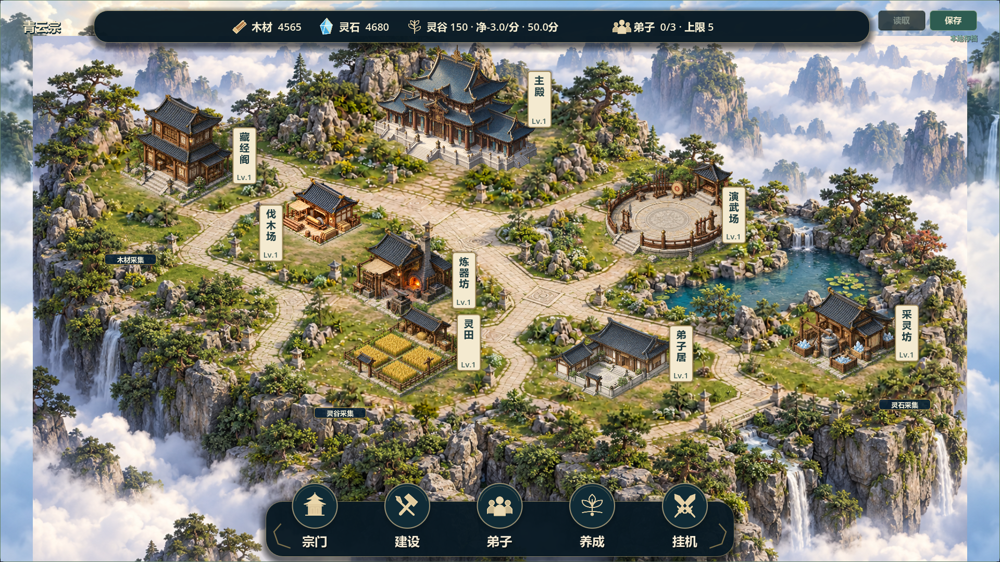

# V0.8 全建筑地面融合试稿22

日期：2026-10-23。关联#37/#38，状态TESTED / 待负责人视觉验收。负责人“试一下全部建筑”是扩大试做范围的授权，不代表候选21或V0.8已验收。

## 改了什么

- 主殿、藏经阁、伐木场、炼器坊、演武场、弟子居、灵田、采灵坊全部纳入地面处理。
- 清除原背景固定地块边框/纹样，以自然土草地承托。六处石材小院按各自台基两轴映射既有石材，不使用统一方向的大方板。演武场保留本身圆台；灵田不加石板。
- 第一轮实机仍有主殿背景大楼梯和精灵台阶叠加，第二轮清除背景大楼梯、替换为自然石径，保留建筑自身台阶。没有靠旋转建筑修补背景。
- 远景、池水与连接路网保留原底图为主，仅七个局部窗口替换；伐木场继续使用21的素材/地面几何。窗口内细节不是逐像素锁定，不宣称整张地图3D共面。
- 新非持久化`all_ground_alignment`默认true，关闭可同状态回看候选21；建筑位置、脚点、图集、拾取及旧逻辑格/数值/ID/等级/version3不改，弟子居沿用旧校准。

代码仅修改`planar_courtyard_sample.gd`与`sect_map.gd`，新增专项测试/审图脚本、背景素材及来源文档，更新预览入口和任务摘要。GameState、SaveManager、数据目录、场景、project.godot及导出预设均无本轮差异。

## 实际截图

以下均来自同状态Godot实际运行，不是AI效果图。

修改前：`docs/art/v08-grounds22-before.png`；八栋原生尺寸局部图板：`docs/art/v08-grounds22-details.png`。图板只是截图拼排，不是新生产素材。

## 已执行验证

1. 新专项测试先在旧代码有效失败exit1（仅有伐木场校准），接入后检查八院落/两尺寸、六组地面轴、圆台/田地不铺矩形、脚点/拾取不移动及隔离存档往返。初版存档往返用JSON文本直接比较失败；改为解析后的数据比较，游戏存档实现未改。
2. 最终66项快测全部PASS/退出0/无错误：`builds/local-validation/20261023-122532/`，包括迁移/恢复/八小时模拟。素材去除背景楼梯后重新完整运行，前一次122147不作为最终构建唯一证据。
3. 最终实际GPU审图：`builds/grounds22-capture-final.log`，两尺寸38整图（含八栋选中/管理卡，空场/施工仅1920）+32原生局部+1图板，共71张。新增七处院落实际像素采样变化540～724；四处远景/悬崖/道路取样不变，非整张逐像素不变证明。所有八栋前后/原生局部均已生成，已目视全景、图板、主殿/弟子居近景与1280管理卡。
4. 测试结束后串行Windows导出，`builds/grounds22-export.log`退出0无错误；普通、付费演示、七院落展示、自由建造备份四入口隔离APPDATA启动通过，`builds/grounds22-smoke/`。展示日志明确formal save not loaded，发布包没有被当作断言测试使用。
5. `git diff --check`通过，核心/数据/场景/工程配置无差异；原六联建筑图集哈希不变。

最终包：`builds/QingYunSect-v0.8-grounds22-win64.exe`，155868672字节，SHA256 `4291C1951CB466C966CBBA6917D036AF07ADCBB12931F54E814A216D9D29FCCB`。

## 打开与验收

关闭旧窗口，双击根目录`Run-Courtyard-Preview.cmd`。它已指向grounds22，打开独立七院落展示，不加载正式玩家存档；正常游戏仍消耗原资源并等待原工期。

重点判断：所有院落是否还出现交叉双框、台基朝向/石材比例是否协调、主殿石径衔接是否自然、草地是否显得过碎或过多、原生小窗口是否仍像贴纸。主殿复杂台阶与背景、材质锐度/比例仍需负责人审美判断，不记录美术问题全部解决。

未真人鼠标试玩、30分钟真实长稳、联机、另一电脑验证。#37评论6357386490、#38评论6357387798已同步，保持open/TESTED；Project未同步。保留原未提交修改，源码/构建未提交推送。素材和两次完整提示词见`assets/environment/ALL_GROUNDS22.md`。
