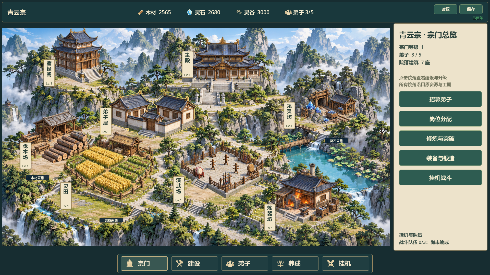

# V0.8 完整宗门29：批准样式与实施记录

2026-10-27，关联 #37/#38。负责人先要求完整游戏目标图，随后确认“可以，看起来这样更好一些，你开始开发吧”。批准对象是当前画布所选图片 `assets/imported/a04f0273-53d2-4fea-ba3a-6d6127bb1db8.png`（1672×941）；这是视觉方向和完整游戏整合的实施授权，不是28、29或V0.8人工验收。替代本轮仅两建筑局部样板的范围限制。

## 设计与影响

目标：正式游戏展示主殿、弟子居、伐木场、采灵坊、灵田、演武场、炼器坊、藏经阁，青瓦暖木、灰石与松绿统一；顶部资源、底部五分类导航、右侧管理。保留招募、岗位、修炼突破、装备锻造、自动战斗、宗门发展、领地及存读档。参考图的数字、额外风景建筑不作为新玩法或改数值的依据。

采用原完整 `main.tscn/main.gd`，而非再新增简化样板。继续现有固定院落多实例管理。新视觉仅显示映射：原ID、逻辑格、等级、数量、104×52/12×8、成本工期、公式、GameState、SaveManager和version3不变。不免费填满正式玩家院落，不读取玩家正式档进行验证。原24/27/28与自由建造备份保留，使用显式旧美术入口回看。

生产路径：以批准图为同一参考，通过画布共享生成历史，分别制作无建筑地形及真实RGBA八建筑图集，按真实实例状态独立绘制与alpha拾取。两图均1672×941；图集未遵守等分列，已按实际图手工标定不重叠取样框，不能使用均分格切图。源图保留；生产副本为 `assets/environment/complete-sect29-ground.png` 和 `assets/buildings/complete-sect29-atlas.png`，启用mipmaps。生成相机/地形与建筑近似统一，不声称精确三维共面或逐像素复现概念图。无NPC动画、额外玩法或等级专属造型。

影响链：main启动/分类管理 → sect_map固定绘制与拾取 → fixed_sect_view委托新显示 → 原固定卡片/原建设保存与回滚。修改点限新完整视觉模块、完整HUD适配、上述接线、专项/审图、启动器和交接；不重构核心经营和战斗。

## 实施计划（沿用本记录，不另建任务账本）

- [x] 1. 先红测：完整主场景启用新视觉，八场所齐全；旧ID/格坐标和资源不因显示变化；七种空院不能显示完工建筑。
- [x] 2. 生成空地形，核对实图；按实际alpha图集标定独立院落绘制/拾取/施工范围，`--legacy-fixed-art` 回退旧24绘制链。
- [x] 3. 接入资源栏、紧凑五分类导航和右侧快捷管理，复用现有操作信号；完整功能仍可达，卡片不压底栏。
- [x] 4. 专项验证：原付费建设/工期、多实例身份与失败回滚、保存往返；双尺寸入口与选择；查看真实GPU截图。
- [x] 5. 72项既有快速回归加新专项；测试与Windows导出串行，独立APPDATA启动普通/试玩/旧入口。记录系统证书、正式档哈希与人工试玩等未验证项，不以无头通过当美术验收。

## 执行约束

当前feature分支已有未提交27/28和导入图片，本轮直接接续该工作区，不搬移或覆盖既有成果，不建第二套worktree/台账，不自动提交推送、关Issue或升级引擎。GitHub全文/评论已读取：#37/#38仍open/TESTED，最近远端为2026-10-26；本次授权以当前会话最新决定为准。Git本地领先4提交，远端配置已核对；另一电脑当前工作区未验证。

## 验证记录

专项第一次有效红测退出1，缺少正式入口complete_sect视觉；完成后退出0/PASS。增强检查包括真实alpha、空院/施工/完工、实际不透明建筑像素及纸牌选择、施工架中心/不可见屋顶负向命中、七类原成本工期、五类真实功能控件、显示不改旧身份/格坐标/数量、保存失败完整回滚与version3隔离往返。

第一轮GPU审图脚本在首次绘制前读取未初始化atlas，日志报null；不是游戏缺图，显式prepare后重跑双尺寸18张截图PASS/退出0/无ERROR，`builds/complete29-check/gpu-second.log`。已目视1080p完工、720p空院/弟子居卡/挂机界面。右侧详情占用原管理抽屉宽度，展开时可覆盖部分场景；默认总览约占19%宽度。地图区域留出右侧总览，院落卡停靠右侧，不覆盖建筑或底栏。

首轮73项快测69 PASS/4 FAIL：all_ground_alignment/courtyard_blend/fixed_construction_ground/planar_courtyard均仍按历史候选16/18/22/23原图脚点及投影检查新版29。核对断言与实际调用链后，仅在这四个历史夹具显式设complete_sect=false，保持原断言，继续验证保留的旧绘制；新版另由test_complete_sect覆盖。未放宽错误/PASS/退出码标准。

独立只读审查发现新资源栏将净产出/派遣数移到悬停说明，但旧资源按钮IGNORE鼠标；有效红测复现，修为PASS鼠标过滤并保留可见“缺粮”提示，专项再PASS。审查未运行测试，其结论与自动测试分开记录。

正式入口 `Run-QingYunSect.cmd` 延续玩家原档、无免费建筑；`Run-Complete-Sect-Preview.cmd` 走现有fixed-layout-showcase隔离档，扣原成本完成七院落供查看全景，仍是完整main.tscn并可操作原功能；不是两建筑样板。两者对应同一29包。旧样板启动器保留。目标图批准不等于实机完成或ACCEPTED。

最终73项快测全部PASS、0失败/无超时、退出0，日志 `builds/local-validation/20261027-185600/`；新专项还覆盖经营悬停入口和可见缺粮提示。最终GPU两尺寸18张实机图，`builds/complete29-check/gpu-final.log` PASS/退出0/无ERROR；截图生产副本 `docs/art/v08-complete29-{built,empty,card,battle}.png`，已放画布并通过引用检查。不是使用生成图证明运行。独立审查只读，未运行测试；本机调试测试/GPU结果由主执行者复核。

导入首次受限编辑器设置路径报错；使用仓库已有模板的隔离APPDATA重导入成功。调试测试/GPU使用临时override.cfg指定本机已有Git证书包；文件导出前已移除。Windows使用本机实际4.7.2和既有模板串行导出，退出0，包206828920字节，SHA256 `D177411128D49C48D96C1B4075F2489851EF4B367C8FB421EDDBABD50184D15D`。正式/完整展示/付费施工/旧24/旧28/旧27/自由建造七入口均隔离APPDATA图形启动，退出0，无脚本错误；**导出和各次启动仍有系统根证书库ERROR，故不计Windows无错误验证通过**。日志 `builds/complete29-check/export.log`、`smoke/results.json`。本次检查正式存档目录无savegame.json*，不能声称验证了真实旧玩家档哈希；验证期间未产生正式档，合成旧档迁移/往返测试通过。

生产地形SHA256 `ED882CACB00AFDD5DE7191F588D69DE8E68213A9DAFBF09B5F5F99ACF4CD52BC`，建筑图集SHA256 `7B3748CC5B218AE77540A3E657582ED84DBEA2BFFC7213FD44F794778F50094A`。生成模型codex-cli/codex-image，参考为负责人导入目标图，完整提示词与来源引用见当前画布两个生成节点及共享历史；原始图output-2.png/output-3.png保留。沿用项目AI生成素材来源规范，不引入外部下载素材或依赖。

没有真人鼠标操作验收、独立人工视觉验收、另一电脑验证、联机或30分钟真实长稳。新建筑外形/布局接近批准目标，但并非逐像素复刻；地形仍为烘焙2D图，建筑为独立透明图层，无精确3D共面承诺。当前停在完整游戏候选交付，等待负责人试玩，不自动推进下一版本。GitHub/Project本次证据未写入，源码未提交推送。

