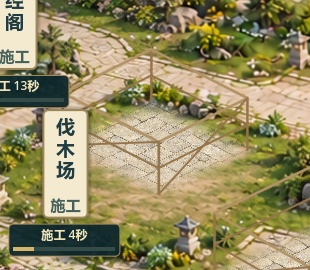

# V0.8 施工接地与拾取修正23

2026-10-23，关联#38，TESTED / 待负责人验收。负责人“继续开发”后继续现有V0.8表现修整，不进入V0.9，不视为22整图验收。

## 原因与改动

grounds22施工实机显示：固定院落仍调用旧`_draw_construction_site(foot)`，脚手架固定屏幕尺寸，落在新院坪下方；未完工实例还按未显示的完整建筑Alpha拾取。

仅修改`fixed_sect_view.gd`：

- 七类建筑的临时施工架按各自台基生成并随院落比例缩放。复用22地面几何；演武场/灵田没有石院，使用其未来精灵脚部参考区，只生成临时木架，不铺永久矩形板。
- 立柱保持屏幕竖直，横梁/撑杆沿地面轴；移除旧直立半透明矩形。复用原木架配色与Godot线条，不生成或替换素材。
- 选中以架体梁柱变亮表现。施工点击范围为实际架体的凸包，包含框架内部留空，不是逐木杆命中；凸包外的不可见完工屋顶不再抢选。
- 同类已有完工实例时继续显示完工建筑与已有施工进度，不用木架覆盖。空地纸牌、进度条、完工拾取保留。
- 原自由建造备份仍调用旧施工绘制函数，未借此删除旧实现。

无成本、工期、收益、ID、逻辑格、等级、资源、存档version3变化；核心、数据、场景及工程配置无差异。背景/建筑PNG均未改。

## 实机

七处同时施工：`docs/art/v08-construction23-working.png`；完工后：`docs/art/v08-construction23-completed.png`。旧偏移证据为`builds/v08-scene-audit/grounds22-construction-1920x1080.png`，非同状态严格像素对照，不把不同施工数量造成的画面差异当修复效果。

## 验证

- 专项有效红测：旧实现缺少共地基施工几何，退出1，`builds/construction23-red.log`；新实现检查七类两尺寸立柱/脚点/点击、凸包外真实未来屋顶不抢选、完成与隔离存档往返PASS。
- 测试初稿要求每一栋都有凸包外的屋顶，弟子居因架体范围覆盖屋顶没有可用夹具点；改为仅对实际存在的外部屋顶检查，并保证双尺寸循环中确实测试了有效样本，不修改游戏逻辑来迎合夹具。
- 最终67快测全PASS：`builds/local-validation/20261023-183512/`，退出0、无错误，含迁移/恢复/8小时模拟；真实30分钟长稳未跑。
- GPU两尺寸16图：七架同时施工、选中、卡片、完工各两尺寸整图与伐木场局部。`builds/construction23-capture.log`退出0无错误；截图等待中游戏数据保持不变，已目视局部、1280全景和卡片。
- 测试结束后串行Windows导出：`builds/construction23-export.log`退出0无错误。普通、独立付费演示、七院落展示、自由建造备份四入口隔离APPDATA启动通过，`builds/construction23-smoke/`；展示明确formal save not loaded。
- 包：`builds/QingYunSect-v0.8-construction23-win64.exe`，155870352字节，SHA256 `84D9BA5E7D95190AE740DD9BD71FD037E14DC318F3B2D3F76AD04606E58CD7FC`。
- `git diff --check`通过，`git diff -- scripts/core scripts/data scenes project.godot export_presets.cfg`为空，原脏工作区保留。

## 如何测试

1. 关闭旧窗口，双击根目录`Run-Construction-Test.cmd`。使用已有`--fixed-layout-demo`独立演示档，开局空院落；不读正式档、不自动存档。
2. 点伐木场等“待建”纸牌，按原资源/工期建设；观察木架是否位于院坪上，点击木架中部是否打开对应卡片。
3. 等原工期结束，确认主体出现在同一地块，木架消失；原进度/管理/升级功能保持。
4. `Run-Courtyard-Preview.cmd`仍打开全部完工院落，现指向23包；如只想看整图可用它。

未执行真人鼠标试玩、真实30分钟长稳、联机和另一电脑验证；无新增美术终稿/人物动态或玩法。#38评论6363050115已同步、保持open/TESTED，Project未同步；未提交推送。施工样式和22整体美术仍需负责人确认。
