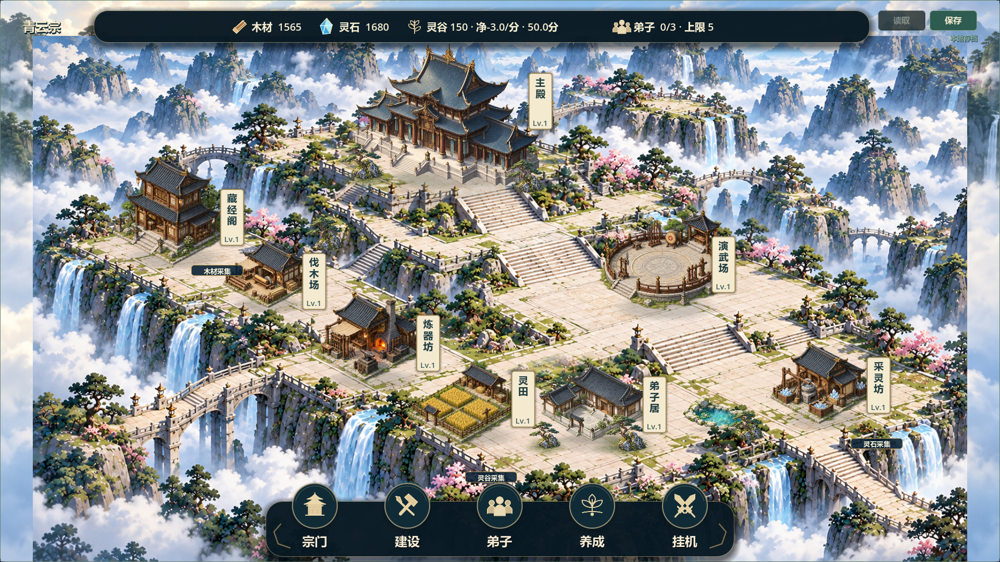

# V0.8 主殿—前庭—弟子居融合样板：候选16

2026-10-22，继续V08-003/#37和V08-004/#38。负责人指出“场景和建筑融合的很差”，随后明确授权“进行优化”。本轮按已讨论的局部样板实施，不是V0.8验收，不开发新玩法或推广其余院落。

## 交付与边界

- 主殿/弟子居两块背景窗口使用局部ImageGen改稿，边缘羽化；保留原底图、岛屿轮廓、其余院落及原脚点。不将重新生成的整张场景直接覆盖全图。
- 入口连接从现有建筑profile的真实entrance生成，主殿通向原长阶上沿，弟子居接入同层前庭；取消两栋原先孤立的小石片。修正首轮铺装偏灰问题，最终采用暖石色和淡接缝，末端渐隐。
- 新增五件复用松石构件及低矮苔草过渡，按脚点与建筑混排；主殿和弟子居用宽浅环境影及近台基接触影。首轮过小的盆景比例已放大。名称牌、进度与点击保持原顺序和规则。
- 原背景保留，`sect_map.fixed_courtyard_blend=false`可用于同状态审图对照；开关不进入存档，普通固定模式默认应用局部样板，自由建造备份不走该渲染链。
- 不改建筑位图、旧ID/逻辑坐标/数量/等级、付费成本/工期/生产、12×8/104×52和version3；不读取正式玩家档。

## 打开测试

双击根目录`Run-Courtyard-Preview.cmd`：打开七院落展示，使用既有独立演示档与停用自动保存逻辑，不加载正式档。仅为视觉验收夹具，七建筑不是免费送入玩家存档。

正式继续游戏可双击`builds/QingYunSect-v0.8-blend16-win64.exe`，沿用原存档。构建不入Git，另一设备需本地导出。

导出命令（Godot 4.7.2与已安装Windows导出模板）：

```powershell
& '<本机Godot控制台程序>' --headless --path . --export-release 'Windows Desktop' builds/QingYunSect-v0.8-blend16-win64.exe
```

Windows包142961672字节，SHA256：`9D5D15F9C985AEE18F7B77432E2C2DD99206AFD66D8C871B40FDA623675FEAAB`。

## 验证证据

- Godot 4.7.2标准调试引擎，全量快速回归61/61 PASS，退出0、无错误；日志`builds/local-validation/20261022-133147/`。包含新增入口连通、两尺寸命中/深度/范围、施工状态、视觉查询不变更数据、存档往返及既有两个8小时模拟。
- 新测试首轮用JSON字符串比较，因数值序列化差异断言失败；改为JSON往返归一化语义比较。随后一次重跑发现前次失败残留隔离测试档，已补测试开始清理，仅处理该测试自己的路径，最终全量通过。以上失败不计作通过。
- 图形引擎OpenGL/RTX5070Ti；1280×720、1920×1080，空院落/施工/局部完工/同状态优化前后/详情卡，共12张实际截图。`builds/blend16-capture-final.log` PASS，无错误；目视检查大图完工与小图局部样板。
- 首次受限导入有Safe save错误，废弃该次记录；隔离环境放宽执行后最终导入、导出日志无错误。最终Windows普通、付费演示、完整展示、自由建造备份四入口均隔离APPDATA启动退出0、无错误；展示日志明确`buildings=7; formal save not loaded`。
- `git diff --check`通过。未做真人鼠标试玩、30分钟真实长稳、联机；无头包启动不等同完整试玩。未上传源码或宣称版本完成。

## 实际运行对照

优化前（同一状态）：


局部优化后：



## 待负责人确认

优先看主殿和弟子居的台基接地、入口与松石比例，以及草地/铺装衔接是否比原版自然。不将少量绿化等同彻底解决风格差异：其余六院落尚未推广；建筑与背景的笔触、原烘焙地形仍有差异，也没有重做建筑模型或改变全图石板比例。确认方向后再迭代/扩展，不能把本轮当作场景美术定稿。

素材与完整提示词见`assets/environment/COURTYARD_BLEND16.md`；内置ImageGen用于局部背景改稿，植被与阴影使用已登记素材和原生代码。#37/#38保持TESTED/open，等待明确视觉验收；Project镜像未同步。
