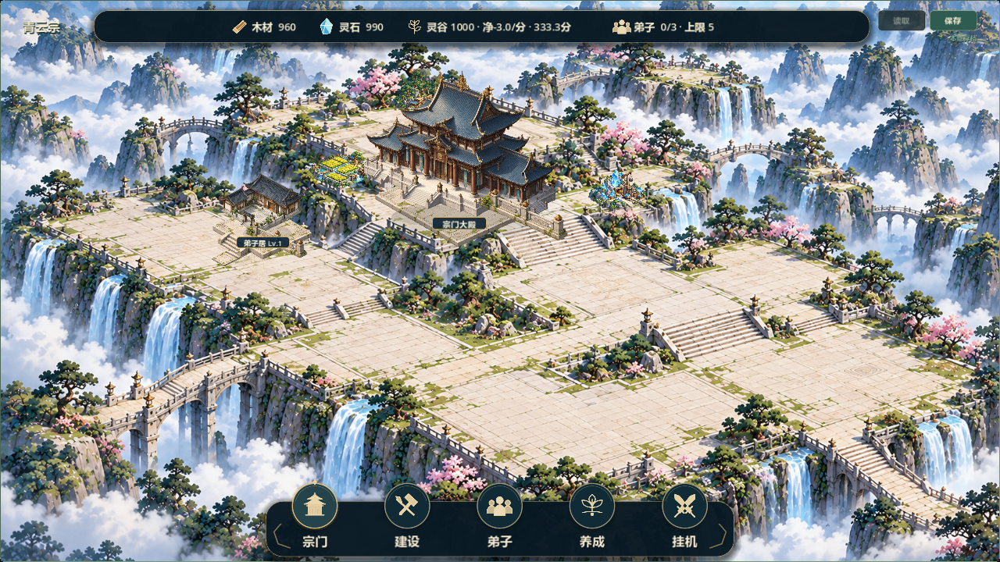
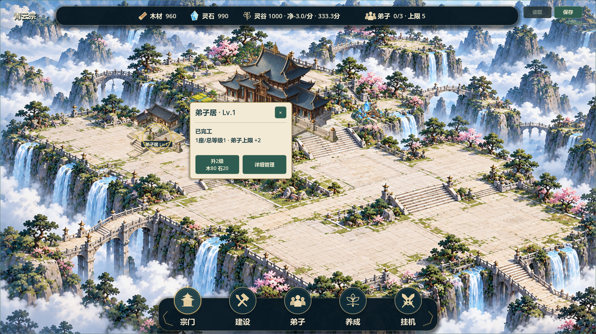
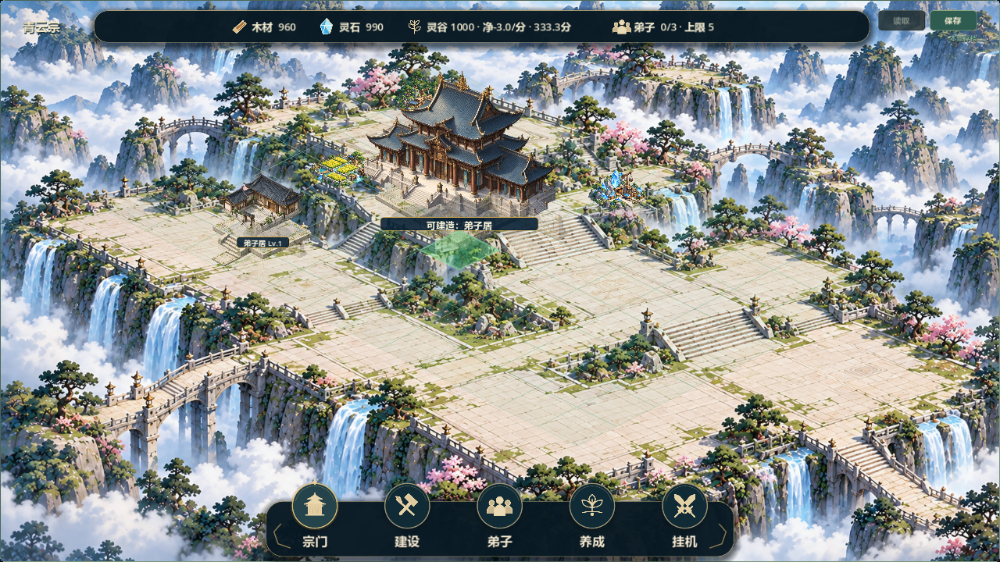

# V0.8 主殿—前庭—侧翼融合候选7

**2026-10-21后续结论：负责人指出本候选与底层地图穿模，未通过视觉验收。以下是历史实现/测试记录，测试通过不代表融合效果获认可。整改候选8见V0.8_TERRAIN_REBUILD.md；局部入口已更新，不再指向fusion7。**

日期2026-10-20，关联#37/#38。负责人明确要求先完成这个局部：入口、道路、台基、阴影与前景遮挡连起来，用实际截图检查。基线47c2425，feature/v0.8-visual-polish；已读Issue全文/评论、本地规划/任务/交接/存档边界，git fetch成功，未切换/重置/合并。原docs/LOCAL_ENV_SETUP.md及tests/run_all_tests.sh保留，未直接核对另一台电脑。

## 本次实现

- 独立透明台基、踏步、低栏杆，来源/完整提示词/哈希见assets/environment/COURTYARD_FUSION.md。主殿接地影改为分层扁平影；铺装和影子先于主体，低栏杆再按落地点深度与建筑排序。
- courtyard_fusion.gd只描述局部渲染计划。主殿固定，左侧520逻辑像素内既有已完工弟子居/藏经阁择最近者作为侧翼；没有合适建筑只显示主殿局部。该条件仅选视觉连接对象，不是建造分区限制。平局按实例ID稳定选择，不修改GameState数组或建筑。
- 初稿大台基和直连短路在截图中显得悬空，未采用。实际迭代收小并回收主殿新增铺装，侧翼踏步贴到门前；道路中段沿用底图连续石路/主阶，只用同材质UV补入口两端接缝，避免把新路悬在园林凹地上。没有声称全部道路已拆成独立物件。
- 两处低栏杆可部分遮住所属建筑台基，不能遮住屋顶主体；进入真实排序而非全局最上层。纯视觉项在拾取中跳过，其他旧建筑/新施工进入装饰落点时栏杆隐藏，建造时栏杆alpha降为0.32，预览最后绘制。原零散池水/圆形广场保留为无新图集时的渲染回退，正常本局部由新庭院取代。
- 新--courtyard-demo仅使用user://v08_courtyard_visual_demo.json，在首次has_save/load前切换路径，普通入口不预置建筑、不读演示。演示仅一栋弟子居(2,6)，全区解锁方便验证，不写入真实玩家档。旧全图演示入口保留。

## 规则和存档影响

12×8、104×52逻辑投影、1.45视觉间距、主殿(4,3)、原建筑ID/类型/位置/等级、资源公式及version3全部保持。GameState/SaveManager代码不改、不迁移、不清档，不减少合法格；纯视觉铺装/栏杆没有新增碰撞或占地规则。未引入玩法、功能建筑或复杂依赖。

## 验证

- Godot4.7.2调试引擎55项快速回归均退出0/PASS/无错误，各45秒超时，日志builds/local-validation/fusion7-final-test_*.log；最后道路/台基/前景位置调整后，test_courtyard_fusion与test_scene_render_layers再次PASS，日志fusion7-verified-*.log。不将早先55项描述为最后每次几何微调后的全量重跑。
- 新专项检查图集取样范围/透明角、渲染计划、前景在所属建筑之后排序；直接寻找栏杆和建筑同时不透明的像素，确认拾取仍返回原建筑；96格合法性不变；其他施工进入时栏杆让位；完整version3保存/读取语义相同。只使用res://tests/.test_courtyard_fusion.json并清理主档/备份/临时文件，不触及正式存档。
- audit_v08_courtyard实际渲染1280×720/1920×1080，各正常、侧翼卡、主殿卡、建造预览，共8图，最终退出0/PASS/无错误。目视检查双尺寸正常、1920侧翼卡，修正了过大平台与悬空短路；素材/台基/低栏杆改善接地与局部前后关系，保留原青蓝云山、暖木青瓦、米白台地基调。日志fusion7-capture-final.log，原图builds/v08-scene-audit/fusion7-*.png，精选docs/art/v08-fusion7-*.png。
- Windows串行导出退出0无错误，APPDATA隔离普通、局部演示、七建筑演示三入口启动PASS；局部日志确认1栋、全图7栋且formal save not loaded，日志fusion7-export.log、fusion7-package-normal/courtyard/full.log。发行包只作启动证据，不替代调试断言或人工可视化试玩。
- git diff --check通过；未真人鼠标试玩、联机、双机或30分钟真实长稳。自动测试、截图不代表负责人已验收。

## 交付与停止点

builds/QingYunSect-v0.8-fusion7-win64.exe，130632496字节，SHA256 **587DD4B8E48B7AA0203FF327FA51B99518C984B289ADEDF483040011ACEB2F15**。

双击builds/Run-Courtyard-Demo.cmd检查本局部，旧Run-Full-Scene-Demo.cmd及候选6保留作对照。普通EXE继续原存档流程。相关Issue已追加证据，保持open待局部视觉验收，Project镜像未同步，未推送源码/构建。

已实现独立接地素材、局部入口衔接、分层阴影和可验证的前景遮挡；未完成全图地形拆分、全部旧位置接缝校准、资源点调色、人物或等级独立造型。新铺装与烘焙地形仍有风化纹理/接缝差异，不能称为和参考完全一致。先等待负责人检查本局部，继续迭代本局部，不自动推广到其他台地或进入V0.9。

