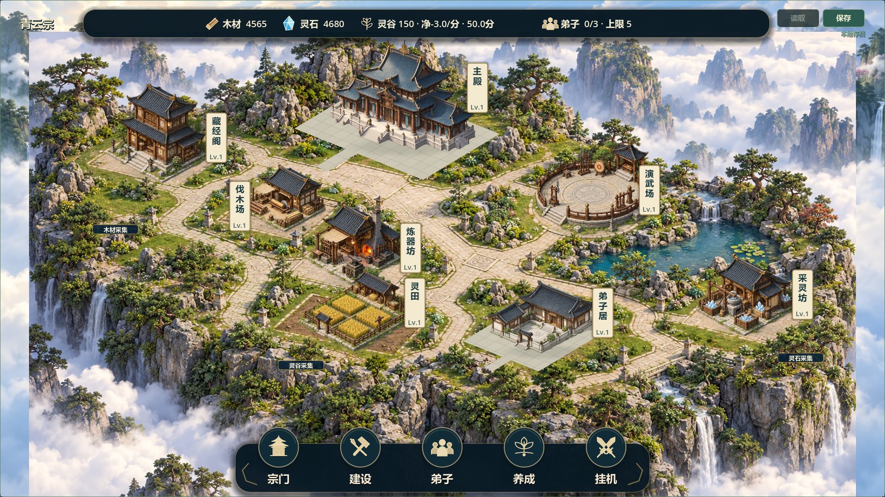
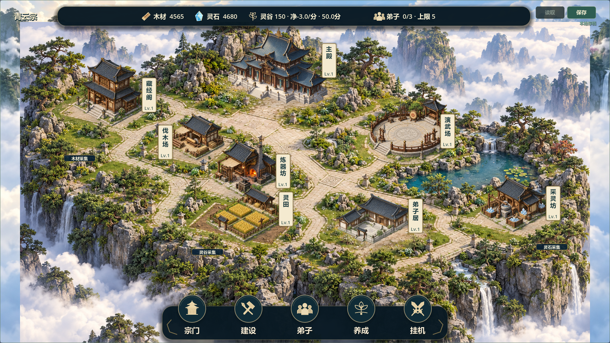

# V0.8 局部材质地面试稿：候选19

日期：2026-10-23。关联Issue #37/#38，状态TESTED/open，待负责人视觉验收。V0.7仍为最新已验收版本，候选18素色网格板被负责人否定，不记验收。

## 本轮改变

- 负责人同意先试“保留远景、重做统一近景”。只替换主殿/弟子居两个既有羽化窗口的地面内容，其他六院落、云海和山崖继续原背景。
- 取消素色网格板及短条铺装，接入带石材纹理、草地边缘与入口过渡的局部地面。独立建筑没有烘焙进背景，仍按原实例展示、选中和管理。
- 保留候选18的脚点锚定、弟子居整体仿射校准/逆变换拾取和仅开发用投影轴。院坪几何轴不再作为可见地面材质。
- 新素材来源与完整提示词见`assets/environment/COURTYARD_GROUND19.md`；旧素材保留。使用内置ImageGen，没有外部素材下载。
- 补`.agents/.gdignore`及本地`builds/.gdignore`，避免技能附件/下载来源被Godot扫描导入；不改变玩法或正式导出预设。

## 本地查看

双击根目录`Run-Courtyard-Preview.cmd`，打开独立七院落展示，不加载正式存档。也可直接用Godot打开本项目运行正常模式。

Windows包：`builds/QingYunSect-v0.8-courtyard19-win64.exe`，150592136字节。

SHA256：`F338C282D92FBE4F3A37FE0C86362DFB6ABA72C0480A5AFD6E654F24C480986D`。

构建不入Git；另一台电脑需拉取源码后用匹配Godot4.7.2模板重新导出。既有plane18包未验证且已被否定，不作为当前交付。

## 验证证据

- 63项快速回归最终PASS/退出0/无错误，`builds/local-validation/20261023-105734/`；含两组8小时模拟，跳过30分钟真实运行。
- 图形审计两尺寸1280×720、1920×1080共14张实际渲染图，覆盖空场、施工、局部完工、导引轴、完整场景、选中和详情卡；`builds/courtyard19-capture-final.log`，GPU RTX5070Ti/OpenGL。
- 画面回归先实际恢复旧板做负向检查：两尺寸石材取样量化变化18/17，退出1；移除旧板后68/65，退出0。取样经viewport最终变换校正，不拿常量标记代替画面行为。此检查仅能排除本次素色板，不代表透视/风格审美自动通过。
- 最初逻辑测试试用了Script常量调用，发生解析错误后修正，随后移除此类标记测试，保留真实渲染检测。最初图形取样未计viewport缩放、未能拦截旧板，已纠正并完成上述红绿验证；早期成功日志不作为最终证据。
- 快测全部结束后串行导出，`builds/courtyard19-export.log`无错误。四入口隔离APPDATA启动退出0且无错误，`builds/courtyard19-smoke/`；展示日志明确7建筑和formal save not loaded。
- 未修改GameState、SaveManager、data、核心公式、场景结构、实例ID/逻辑格或version3；未读取正式玩家档。
- 本轮未真人鼠标试玩、30分钟真实长稳、联机或另一电脑验证；未提交/推送源码。

## 实际画面对照

修改前：

修改后：

## 等待负责人确认

1. 主殿与弟子居脚下是否不再像独立硬板，石材/草地过渡是否接受。
2. 建筑台阶落点、石径方向与比例在实际尺寸下是否协调。
3. 点击、轮廓、关闭详情和原有操作是否正常。

这是局部试稿：近景仍为2D生成素材，投影线向未被证明精确统一为可编辑3D；其他院落没有重做。只有负责人认可此实机方向后才讨论推广，不据自动测试宣称V0.8或全图完成。
