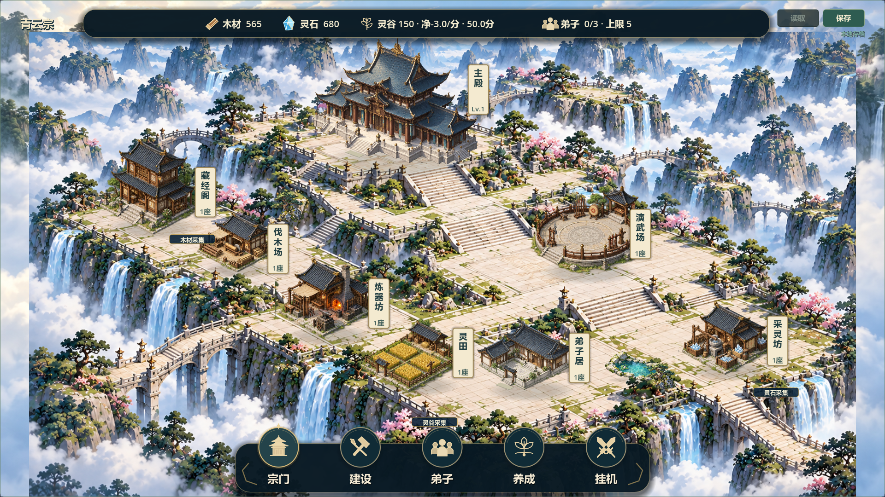
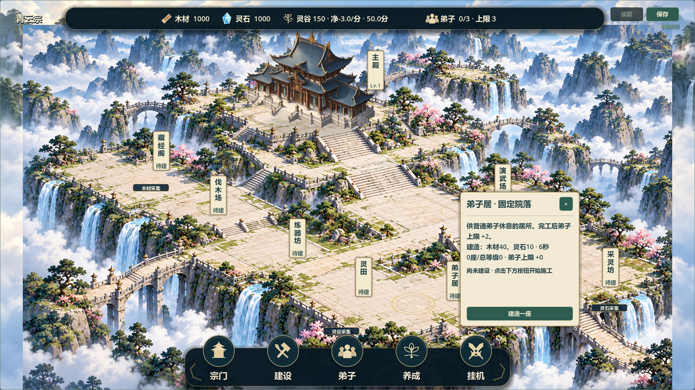
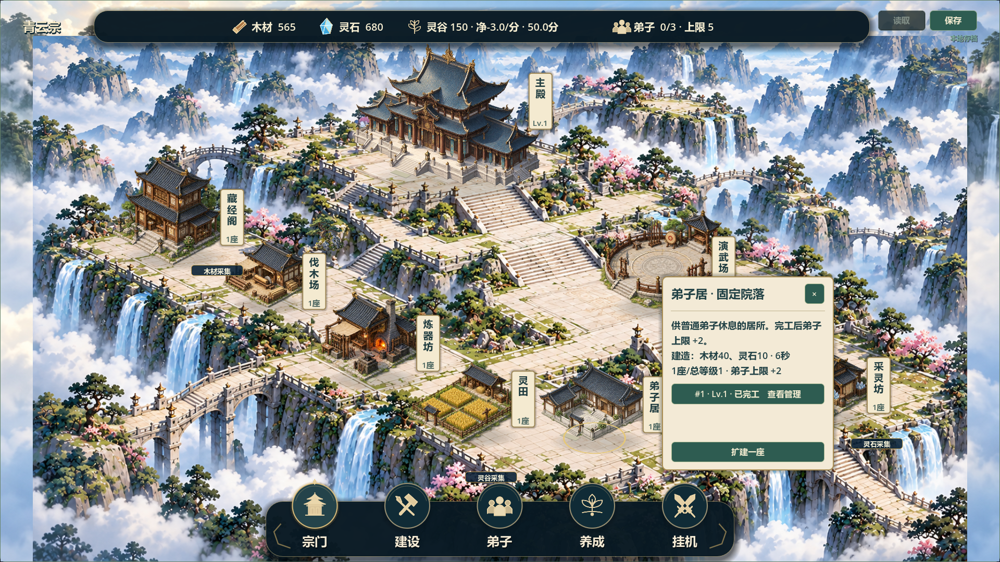

# V0.8 固定院落融合候选12

2026-10-21，继续[#37](https://github.com/C-destiny/QingYunSect/issues/37)、[#38](https://github.com/C-destiny/QingYunSect/issues/38)。负责人授权“继续下一步开发”，不是候选11验收。历史已验收版本V0.7，当前V0.8仍待验收；基线c7b6c91，分支feature/v0.8-visual-polish，已fetch，另一电脑未验证，无切换/重置/合并/源码推送，保留原两份未跟踪文件。

## 本轮完成

- 固定模式此前没有调用旧地图阴影层；现在fixed_courtyard_details.gd统一绘制主殿/完工院落的左上光源右下接地软影，阴影层先于所有建筑，待建院落不预画建筑影。
- 门前只补一小段接地石接缝，沿既有入口坐标缩放，不重铺额外台基、不跨背景长阶。三件复用松石/池水构件均按固定原图坐标管理，与建筑交错排序，纸牌最后绘制，景观不拦截点击或占用格子。第一轮松石压侧阶，截图后已移向边缘绿地。
- fixed_site_card.gd保留相同实例列表节点，原位刷新施工/升级文字及按钮状态；只在切换院落或实例增减时重建。main.gd不再每次刷新都关闭已隐藏抽屉，避免焦点被抢回底栏。
- 原成本、工期、结算、旧实例ID/格坐标/等级/数量、12×8与version3保持，无新增存档字段，无修改正式玩家存档，无新增位图或依赖。

## 验证记录

静态：git diff --check通过。自动调试测试：本轮8项相关回归最终全部PASS/退出0/无错误，日志builds/local-validation/fixed12-test_*.log，汇总fixed12-test-results.json：fixed_layout、v08_visual_ui、sample_building_card、quarters_scene_sample、full_scene_visuals、scene_render_layers、territory_expansion、save_manager。

新增12实例滚动位置、键盘焦点及按钮身份保持回归，景观按脚点排序/画布范围/查询不变更数据检查。首轮焦点断言失败，查到关闭抽屉抢焦点后修复复测通过。测试命令曾误用不存在的test_ui_navigation.gd，已使用实际test_v08_visual_ui.gd重跑，错误命令不算通过。

实际图形：Godot 4.7.2、OpenGL/RTX2060，1280×720及1920×1080，共11张空场/建设卡/施工/完工/实例卡/主殿卡截图，最终fixed12-final-capture.log PASS/退出0/无错误。首轮shader缓存目录受限报错，切换仓库内隔离APPDATA后重跑通过。已目视检查两尺寸整体和卡片，未进行真人鼠标试玩。

Windows：导出及普通、空院落付费演示、完工展示、自由建造备份四入口隔离APPDATA启动通过。包builds/QingYunSect-v0.8-fixed12-win64.exe，140480216字节，SHA256：FB4946C157CCFAA79544A780E97C0D235424CAFA6BC4E98958F635885A945765。Run-Fixed-Layout-Demo.cmd和Run-Fixed-Layout-Showcase.cmd均更新到此包。

本轮没有重跑58项全量，未做联机或30分钟真实长稳；Windows无头启动不代表完整人工试玩。

## 实际截图与下一步

固定位置、台地层次和青瓦暖木基调继续对照负责人参考。此轮集中补接地和少量景观，整体构图沿用候选11；园林密度和建筑细节仍有差距，不称完全达到参考图。背景台阶/栏杆仍烘焙，无NPC活动、等级独立造型、可交互桥梁或真实扩图。后续优先按负责人对融合效果反馈继续调整，再考虑人物表现；不擅自新增玩法。

Issue追加证据：#37 comment-6312620727、#38 comment-6312622678，保持open待验收；Project未同步、源码未推送。需负责人核对接地效果、松池位置及多实例管理体验，不以继续开发作为人工验收。
