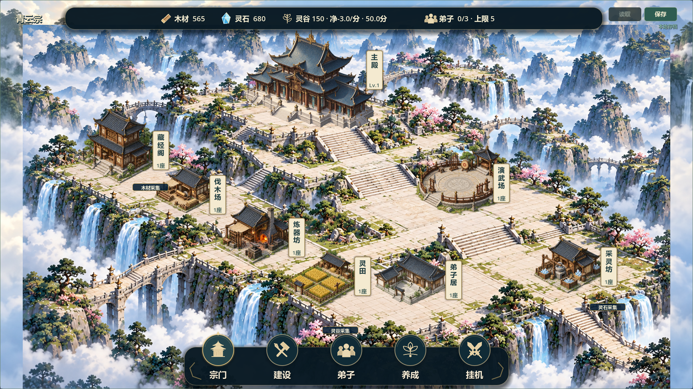
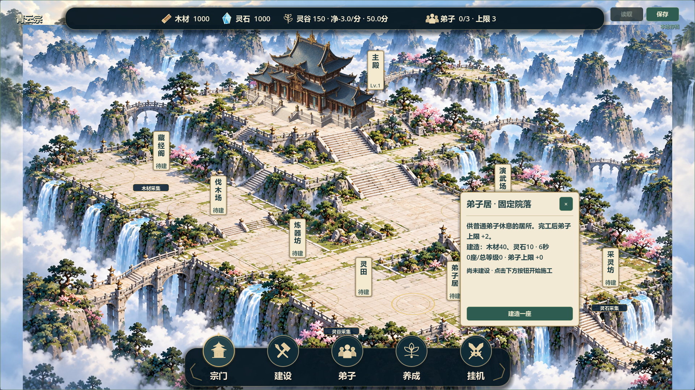
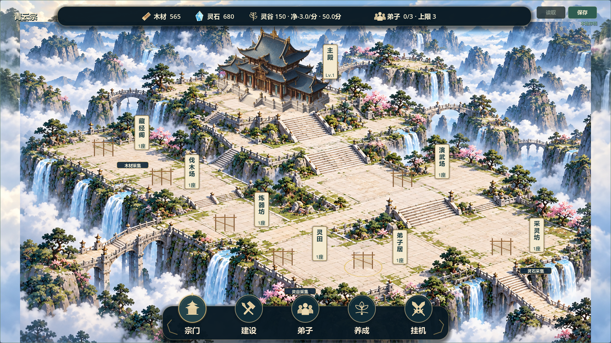
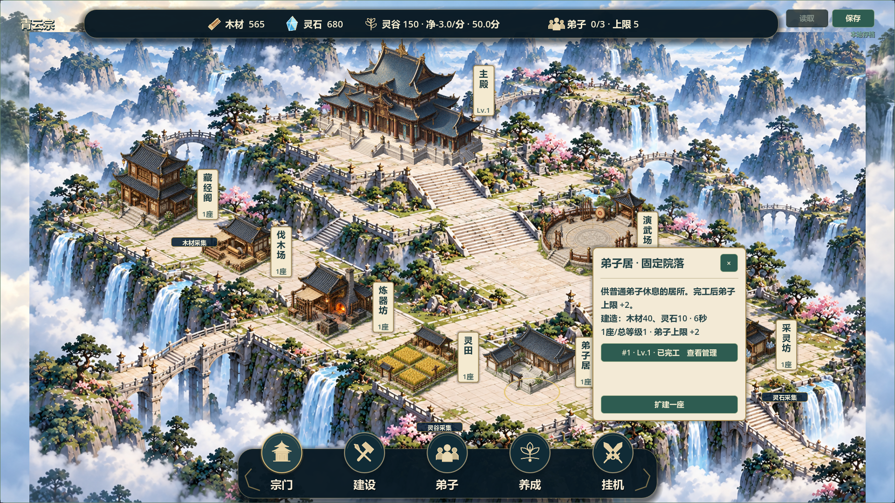

# V0.8 固定院落候选11

日期：2026-10-21。任务：[#37](https://github.com/C-destiny/QingYunSect/issues/37)、[#38](https://github.com/C-destiny/QingYunSect/issues/38)。已编码、已测试，待负责人验收，Issue保持open。

## 批准与基线

负责人提出“将他们改为固定位置生成，同时自由建造规则底层代码保留，但不生效，作为备份”，随后确认“仍需消耗资源建设，然后现在做的要像渲染图”。这次明确更改普通模式摆放规则；原自由建造要求不再约束默认界面，旧数据与经营规则继续保护。本决策不等于候选10或V0.8验收。

基线19a4258，feature/v0.8-visual-polish；已fetch origin，远端功能分支45b35b3，默认分支docs/development-management为e936491，main为b7ca7fa。按提交内容继续本地视觉工作，不切换或合并分支。另一电脑未验证；原未跟踪docs/LOCAL_ENV_SETUP.md和tests/run_all_tests.sh保留，未推送源码。

## 实现与玩法

- 普通入口默认固定主殿、藏经阁、伐木场、炼器坊、演武场、弟子居、灵田、采灵坊。复用多台地背景，按环境原图配置脚点、尺寸、入口与命中；主殿后置居中，中央台阶和通路留空，两翼各有独立建筑。首轮截图后将灵田、采灵坊向台地内收，避免外缘冲突。
- 空院落显示待建纸牌，点击纸牌或建设菜单进入宣纸卡。仍扣原资源、等原工期、沿原结算产生效果；没有免费解锁七座功能建筑。完成后生成对应建筑，施工显示脚手架。
- 同类可继续建设原有多个实例，统一院落模型显示总座数，卡片列出每个实例ID、等级、施工/升级状态，分别进入原管理界面。未将旧实例强制压成一座，不削减等级/效果。
- 新增fixed_sect_layout.gd负责位置配置、分组和内部空格分配；fixed_sect_view.gd负责绘制/纸牌/拾取；fixed_site_card.gd负责建设与实例入口。main.gd控制默认模式、付费保存及失败回滚，sect_map.gd接入固定绘制与输入。原自由摆放代码保留，仅显式--legacy-free-build开发入口恢复，普通菜单不提供切换。
- 12×8逻辑网格、104×52既有契约、原解锁/占用规则继续运行；新增实例自动找已解锁空格，格满时不能扩建。不写回旧cell_x/y，无新增存档字段，version3不变。地图后续扩展仍通过TerritoryCatalog配置；本轮未真的扩图。

## 验证证据

- 58项快速调试回归全部PASS、退出0且无错误；逐项45秒超时，日志builds/local-validation/fixed11-final-*.log，汇总fixed11-test-results.json。不包含test_real_time_stability.gd的真实长稳。
- 新test_fixed_layout验证默认固定、禁止旧UI放置、扣费/原工期、多个旧实例身份与坐标不变、原容量效果、分组逐项选择、1280×720/1920×1080纸牌点击和卡片安全区、保存失败资源/ID原子回滚、往返和资源不足不变。两项原自由建造卡片测试显式启用备份模式，继续验证旧链路。
- audit_v08_fixed实际GPU运行、两尺寸11张游戏截图：空院落、付费卡、施工、七院落完工、分组卡和主殿卡。最终日志fixed11-final-capture.log为PASS/退出0/无错误。已目视检查布局、卡片、台地边缘，不能视作真人鼠标试玩。
- Windows最终导出通过；首次受限环境报编辑器配置保存错误，废弃后使用已有模板环境重导出无错误。普通/空院落/完整展示/自由建造备份四入口使用隔离APPDATA启动均PASS；启动不等于完整发布包人工游玩。
- 包builds/QingYunSect-v0.8-fixed11-win64.exe，140476392字节，SHA256：30BE41801CDC7E439FCCC08B861DE3BD7DC02C57298EFE34DC6C76AF18CDB68F。

## 打开与对照

普通游戏直接打开上述exe，读取原正式档并用固定院落显示；新建空档仍需付费建设。Run-Fixed-Layout-Demo.cmd使用独立演示档、提供1000资源以试玩付费施工，不改正式档；Run-Fixed-Layout-Showcase.cmd只展示演示内按原成本建设完成的七院落，两者用途不同。

## 与参考图差距及待验收项

固定台地构图、主殿中心、分层通路与建筑落点已明显靠近参考。背景道路/台阶/栏杆仍为烘焙图；建筑仍是独立运行时精灵与点击对象。尚无人物活动、可交互桥梁、动画云瀑、等级专属建筑造型或完整参考图园林密度。一个院落模型代表多个实例，是本方案的明确表现折衷，实例实际收益不合并删减；卡片定时刷新时长列表滚动仍可优化。

新增旧档验证使用隔离合成数据及既有兼容回归，未读取或改写玩家正式档；无人工鼠标试玩、联机或30分钟长稳。等待负责人验收固定院落构图、实际建设体验、旧实例逐项管理及是否继续细化人物/园林。不以此候选宣称V0.8全部完成。

Issue证据：#37 comment-6309305382、#38 comment-6309307085。Project镜像未同步，源码/构建未上传。
