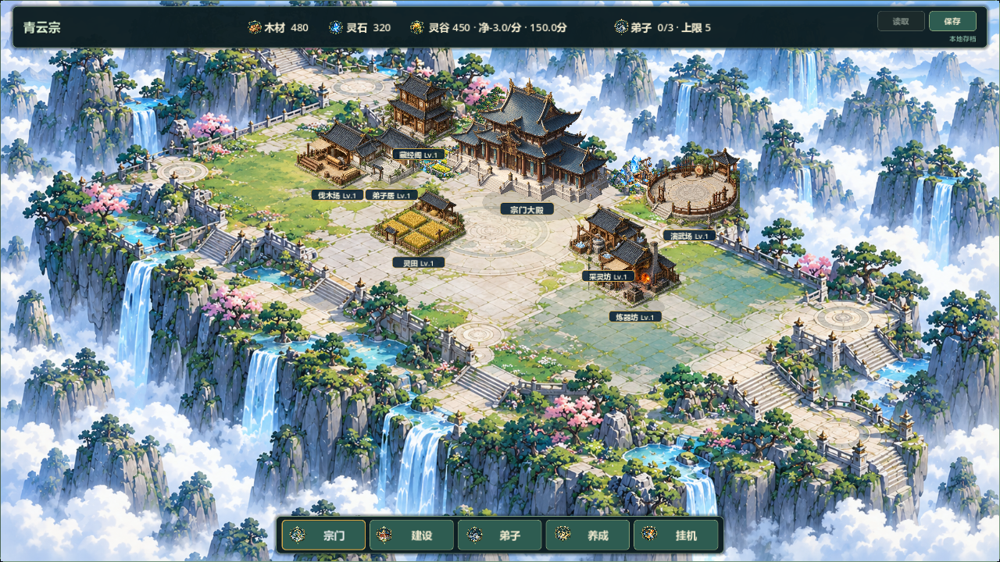
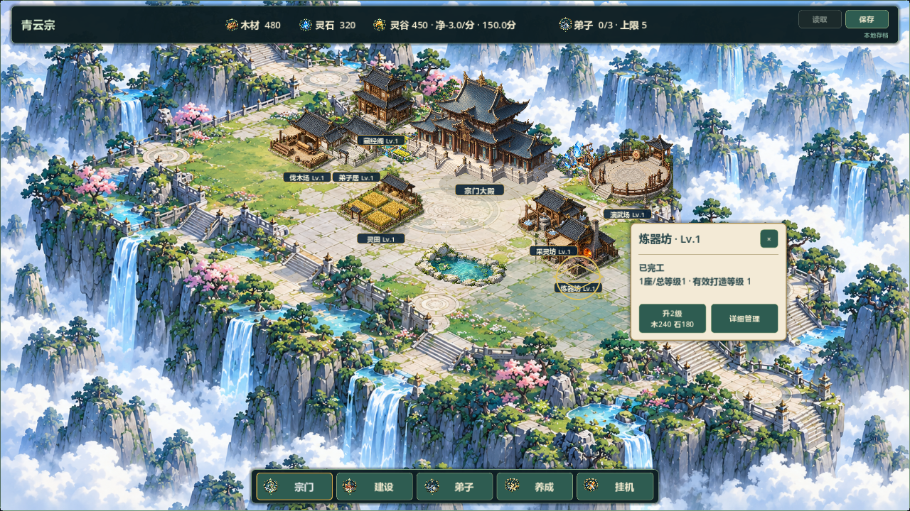
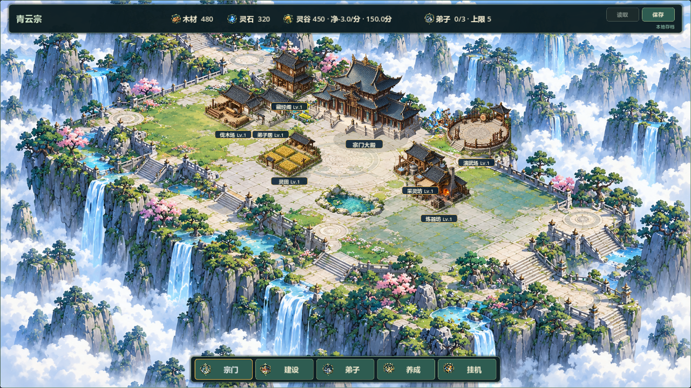
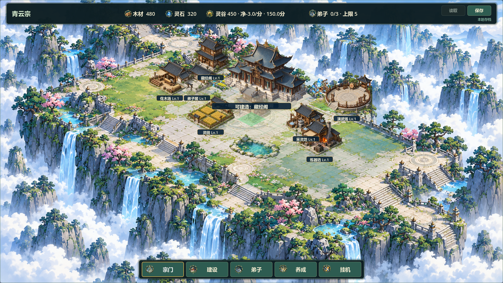

# V0.8 全图推广候选2

## 2026-10-20 追加：阶段2改善清单与候选4

当前阶段为已验收局部样板向全图推广后的持续打磨，V0.7已验收，阶段1已验收，全图阶段2尚待验收。本轮用户明确要求“接着开发，请你再说明一下我们该阶段的改善任务”。当前基线a43a308；GitHub #37/#38全文及评论已重读，仍open/TESTED，原两份未跟踪文件保留；另一台电脑未核对。本轮未再fetch，远端引用沿用前轮成功更新，不将其当双机同步证据。

阶段2任务与当前差距：

| 改善方向 | 已实现 | 继续改善 |
|---|---|---|
| 空间构图 | 固定主殿、独立两翼建筑演示和前庭 | 后殿纵深、完整道路/台阶/园林组织；主体道路仍烘焙 |
| 建筑统一 | 七类统一配置、脚点、投影、台基、影子和贴图预览；入口短石径 | 等级独立造型、资源点与建筑色彩协调、比例精修 |
| 遮挡景观 | 稳定深度排序、主殿透显、景观让位 | 更密集旧档的可读性和相邻建筑关系 |
| 交互UI | alpha选择、四向卡片避让、升级/管理/关闭、模式切换 | 真人鼠标试玩及更多边缘布局核对 |
| 交付验证 | 既有53项快速回归/兼容往返、双尺寸截图、Windows候选 | 每轮按变更验证；最终整体回归、真人试玩及负责人验收 |

本轮仅完成景观让位修复：旧逻辑只查建筑脚点，宽台基可能伸入水面。现在使用建筑实际等级视觉矩形的下部作为保守台基包围区，与池水留8像素间隙；首候选冲突改用备选，两处都冲突则隐藏。保留屋顶正常前后遮挡，不把整片屋顶列为禁放景观区；该范围是渲染近似，不是逐像素建筑碰撞。施工中的建筑同样提前留出视觉空间。没有减少任何合法建造格，没有改道路玩法、资源、存档、主殿或地图边界。

验证：3项相关调试回归test_full_scene_visuals/test_sample_building_card/test_territory_expansion退出0/PASS/无错误，各45秒超时，日志full4-test_*.log；新增脚点外台基相交、备选有面积、双候选冲突隐藏、查询不改状态。full_scene仍含原七类三级、96格自由建造、version3完整往返。本轮没有重复执行53项全量测试，前轮结果仍仅属于候选3。

audit_v08_full_scene输出改为full4-*，两尺寸30张真实渲染图退出0/PASS/无错误；目视正常1280图中七建筑演示两处均不足，池水正确隐藏，前庭恢复空地，不强行增加景观。保留青蓝云山/暖木青瓦/米白台地参考基调，未完成新的远景或等级素材；截图不代替真人操作。证据builds/local-validation/full4-capture.log、docs/art/v08-full4-normal.png。

Windows候选4：builds/QingYunSect-v0.8-full-scene4-win64.exe，126414744字节，SHA256 **E15DE702373E3ED22B313662AFC4D14C78AE2543BDBDB6056925AF332996F715**，串行导出退出0无错误，普通及独立七建筑演示APPDATA隔离启动PASS，日志full4-export.log、full4-package-normal/demo.log。Run-Full-Scene-Demo.cmd已指向候选4。未真人试玩/联机/30分钟长稳，不宣布整阶段完成，不进入V0.9。GitHub #37已追加本轮证据；Project未同步，源码未推送。

## 2026-10-20 追加：候选3交互与地面衔接

负责人明确授权“开始进行相应开发”，本次继续阶段2；未据此记录全图验收。基线61813e9、feature/v0.8-visual-polish，本轮git fetch成功，原有两份未跟踪文件保持；另一台电脑工作区未直接检查。

- 小卡使用实际等级的建筑绘制矩形，改为左右、下、上四向避让，并在安全区约束后计算遮挡；无完全空位时选择遮挡最小的位置。关闭/详细管理/升级沿用原流程。
- 五类有门厅建筑脚下增加低对比度短石径，衔接石台和烘焙地面；灵田/演武场沿用原场地。石径先于网格/阴影/主体绘制，不进入碰撞、占地、存档，也不构成分区限制。没有替换全图烘焙道路。
- test_sample_building_card新增七类×三级×五位置×两尺寸共210组几何布局及两侧不足时上方避让案例，原升级/关闭/管理/模式切换/存档不变测试仍通过。
- 调试引擎53项快速回归最终全部PASS、退出0且无错误，各45秒超时；日志builds/local-validation/full3-test_*.log。30分钟真实长稳未执行。
- audit_v08_full_scene再次实际渲染两尺寸共30图，退出0/PASS/无错误，日志full3-capture.log。该历史脚本仍输出full2-*文件名，本轮覆盖了builds内临时截图；已另存本轮正常/炼器卡到docs/art/v08-full3-*.png。目视检查显示入口石径低对比度、炼器卡避开所选建筑，保持参考图青蓝云山、暖木青瓦和米白台地基调；这次是局部修整，无独立等级造型和远景重绘。
- 初次导出与测试同时运行，扫描到随测试删除的.test_offline_ui.json而报错，该产物已弃用。测试结束后串行重新导出，最终full3-export-final.log退出0且无错误，最终包普通/独立演示两入口均隔离APPDATA启动PASS，日志full3-package-normal/demo.log。无头启动不等于真人鼠标试玩。
- 最终包builds/QingYunSect-v0.8-full-scene3-win64.exe，126414440字节，SHA-256 **62275CD53457C43F8BD305D3C04CA567DEBAD937A42409421AD0236DB2A49ACD**。Run-Full-Scene-Demo.cmd已指向该包；旧候选2保留。
- 12×8、104×52、主殿(4,3)、旧建筑ID/位置、玩法数值及version3完全沿用；不涉及迁移。未新增素材或依赖。
- 已同步[#37记录](https://github.com/C-destiny/QingYunSect/issues/37#issuecomment-6288904535)、[#38记录](https://github.com/C-destiny/QingYunSect/issues/38#issuecomment-6288905477)，Issue保持open待验收，Project镜像未同步，源码未推送。尚未真人试玩、联机和长稳，不进入V0.9。

以下保留候选2历史记录。

日期2026-10-20，关联#36/#37/#38。当前阶段2已编码并完成相关自动/图形验证，整体人工试玩与最终验收待负责人执行，不能宣称整个V0.8完成。

## 阶段1验收与授权

负责人在本会话明确选择“验收当前样板，推广全图”。验收对象为875a230及QingYunSect-v0.8-hall-sample1-win64.exe，原包SHA-256 483142CDB2955AA9DAB4352F1FB3E69003AA3B8758B3A1B8B9583B0F31FEEAE6。

验收范围为主殿局部样板：主殿/侧翼/前庭景观、宣纸卡、建造/坐标/旧档相关验证；保留地面融合/空场/纵深等问题交阶段2继续改善。已记录于GitHub [#37评论](https://github.com/C-destiny/QingYunSect/issues/37#issuecomment-6283780465)及[#38评论](https://github.com/C-destiny/QingYunSect/issues/38#issuecomment-6283781756)。只接受阶段1，不关闭整个Issue或V0.8里程碑。

已fetch更新远端引用：默认docs/development-management、main仍早于V0.8；沿用feature/v0.8-visual-polish，起点875a230，本地领先功能远端10次提交。保护原docs/LOCAL_ENV_SETUP.md、tests/run_all_tests.sh，未切换/重置/合并/推送，另一台电脑工作区未直接检查。

## 阶段2实现

- 生成并接入3×2透明建筑图集，六格分别伐木场、采灵坊、灵田、演武场、炼器坊、藏经阁；弟子居沿用已验收独立素材。青灰瓦、暖木、低石台与左上光源统一，不再各自立于厚岩山上。新素材1536×1024、2836839字节，SHA-256 D971A224251FCBC23C341F8336795AFB3A739B32BDCB9D0234F32111539D2CCF，路径assets/buildings/sect-buildings-unified.png，来源/完整提示词见assets/buildings/UNIFIED_BUILDINGS.md。
- 内置ImageGen前两次带参考请求网络失败；缩小为纯文字规格后生成成功，没有改用CLI/API。纹理角与格间透明采样0，导入成功，最终以游戏实际渲染检查效果，不将生成图当交付截图。
- get_building_visual / get_building_visual_rect统一贴图源、比例、脚点与等级缩放。七类建筑绘制、alpha轮廓选择、建造贴图预览和宣纸卡共用配置，消除旧UI/预览各算一套的差异。
- 建筑影子统一右下扁平接地影，移除旧普通建筑的深色圆盘与Lv3额外蓝色光圈；施工脚手架与升级进度反馈保留。更换素材只影响表现，不改建筑功能/等级效果。
- 建造模式显示真实建筑的半透明预览，使用与新建Lv1相同的脚点、比例、贴图和位置；绿/红地块、叉形及原因文字仍保留。普通经营继续弱化网格。
- 纯视觉池水在附近出现建筑时选择另一处地面位置，两处都不合适则不显示。首次备选压到烘焙栏杆，截图发现后改为前庭内部位置；没有加任何禁建或碰撞。地景始终绘在建筑与建造网格之下。
- 全图独立演示--full-scene-demo：仅用user://v08_full_visual_demo.json，七类各一栋、全区已开，展示后殿/左生活与藏经/右演武工坊/前灵田。显式预置是演示状态，不是强制布局或新档免费建筑。普通入口不调用示例布置，原--visual-sample仍可查看已验收局部。

## 数据与扩图边界

生产地图仍12×8、104×52，主殿(4,3)、资源点及玩家建筑身份/坐标保持。GameState、SaveManager、建筑/资源/区域数值未改，SAVE_VERSION仍3；不迁位、不重置、不新增硬功能分区。所有原合法格仍可自由建造，池水不占地。

范围仍由区域配置推导，未来扩图需新增区域、环境素材及相应兼容验证。本轮未新增无限地图、实际新区域、移动建筑、多格占地、相机缩放拖动或三维引擎迁移。

## 阶段3自动与图形验证

- Godot 4.7.2.stable.official.ed1daf0bf，调试引擎执行53组快速test_*.gd，最终53 PASS/退出0/无SCRIPT ERROR、Parse Error、Assertion failed、ERROR或CRASH，每项45秒超时。日志builds/local-validation/full2-final-test_*.log。30分钟真实长稳1项未重跑。
- 新test_full_scene_visuals.gd：七类三级脚点恒定、源矩形不越界、alpha像素命中/实际选择、全部96格对七种建筑的软分区空间兼容、查询不改数据，以及全七类建筑有效version 3保存/读档后完整JSON语义相同。测试只用合成隔离文件，结束清理主档/备份/临时文件。
- 既有旧档1/2/3、恢复/错误输入、资源、升级拆除、装备、岗位、战斗和管理UI回归通过；未把发行包当断言测试。
- 实际图形命令：Godot --path . --log-file builds/local-validation/full2-capture.log -s res://tests/audit_v08_full_scene.gd，45秒超时，退出0/PASS/无错误。1280×720、1920×1080各正常图、七类建造预览、七类卡片，共30张。已目视检查两尺寸正常、藏经阁预览、炼器坊卡等，修正池水备选遮挡后重拍。图位于builds/v08-scene-audit/full2-*.png。
- 对照参考：保持青蓝云山、青灰瓦、暖木米白台地；七类功能轮廓/材质和建筑接地改善，主殿仍居视觉中心；演示两翼/前庭关系更清楚。原远景/道路仍多为烘焙，不能宣称全环境逐物件交互；三资源点沿用原素材，仍比新建筑更鲜艳，作为剩余美术差异记录。
- 静态git diff --check通过。未执行本轮人工鼠标试玩、双机/联机或30分钟真实长稳；窗口截图与模拟事件不代替负责人验收。

## Windows交付

包builds/QingYunSect-v0.8-full-scene2-win64.exe，126413320字节，SHA-256 F5BBCAB952C8F93C1486E0143F3ED726D3A78D60354605A1135B8988EEFF3393。

导出Godot --headless --path . --export-release 'Windows Desktop' builds/QingYunSect-v0.8-full-scene2-win64.exe --log-file builds/local-validation/full2-export.log，退出0/无错误；确认新图集进入包。隔离APPDATA执行--headless --quit-after 5普通与-- --full-scene-demo两种入口，均退出0/启动成功/无错误，演示日志确认7栋建筑。日志full2-package-normal.log、full2-package-demo.log。无头包启动不是人工可视化试玩。

双击builds/Run-Full-Scene-Demo.cmd进入独立演示；普通EXE继续正常游戏。源码/构建未上传。候选证据已写GitHub [#37](https://github.com/C-destiny/QingYunSect/issues/37#issuecomment-6284308933)与[#38](https://github.com/C-destiny/QingYunSect/issues/38#issuecomment-6284310166)评论，两Issue保持open/TESTED，Project镜像尚未同步。

## 剩余限制与负责人验收项

建筑Lv2/3仍共用素材做原轻微缩放与等级标签，没有独立等级造型；背景远景/道路/部分景物烘焙，角色没有场景行走模拟；资源点与新建筑饱和度仍有差异。新视觉不会自动把玩家旧建筑排成演示图，密集旧档仍可能需要透显与地面格选择。

请负责人核对正常经营全图的建筑比例/接缝/主次、七类建造和点击、卡片升级/详细管理/关闭，以及真实旧档身份/位置/进度。阶段1已接受，阶段2/3候选尚待接受；不自动进入V0.9，不关闭里程碑或标记整个版本完成。
