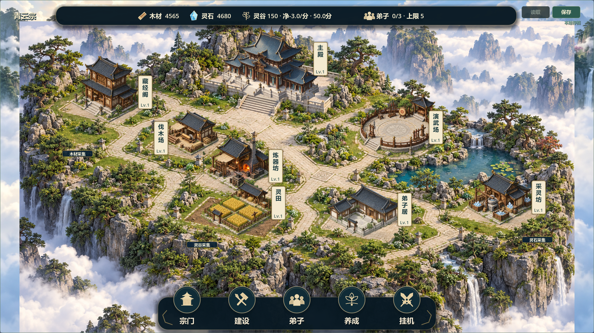
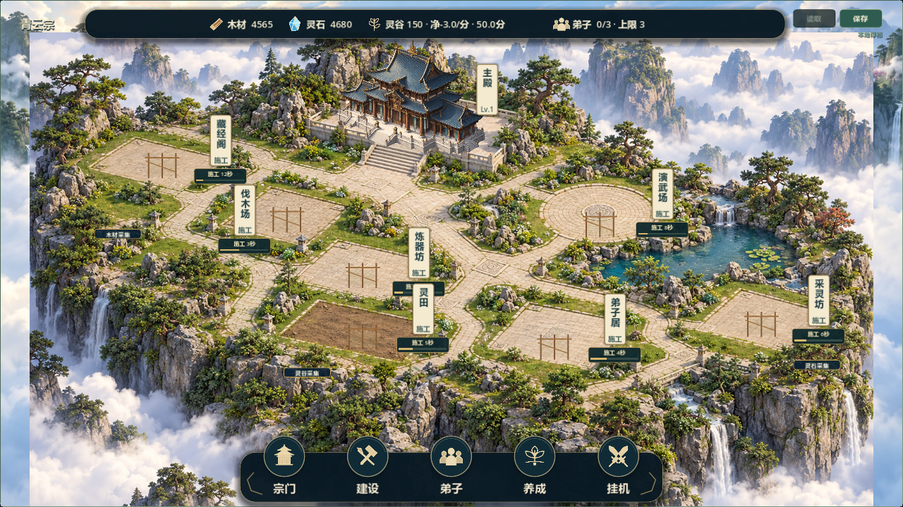

# V0.8 候选17：按建筑风格重制场景背景

日期2026-10-22。V0.7仍为最近已验收版本；继续V0.8 #37/#38。负责人提供主殿、演武场、弟子居三张局部截图，明确指出候选16“融合的还是很差劲”，要求“将背景做改造，根据当前建筑风格进行场景融合化改造”。候选16视觉未获通过，本轮取代其普通场景表现，不记验收。

## 实施

1. 以现有主殿、弟子居独立资产作风格/材质参考重新生成完整环境，不再用旧插画背景作主体。初版编辑旧图仍保留过多旧风格，弃用；最终采用新的连续山顶园林背景，真实尺寸1672×941。
2. 大面积重复广场/长阶改为连续草地、石径、池岸、岩壁和低矮花木，只保留后方主殿抬高院落；地面石材与建筑台基采用相近半写实色调和细节，环境不含烘焙建筑，建造/拆除仍由游戏控制。
3. 校准八处固定显示脚点/尺寸及三处资源标签。仅更改背景像素坐标，不写回旧建筑`cell_x/y`；原ID、等级、数量、多实例管理、成本、工期、收益不变。底层12×8/104×52与version3不变，无存档迁移。
4. 撤下固定场景候选16的羽化窗口、灰色铺装、苔草斑及重复松石/池水贴片，保留轻量接地影。历史素材与代码留存，不作为新普通场景的表现。
5. 第一轮实际截图发现主殿峰顶被HUD挡住，已缩小显示并校准脚点；伐木场名称牌移至左侧，避免压住炼器坊屋顶。UI结构、功能及相应点击逻辑不变。

## 测试与导出

- 最终62项快速全量回归PASS/退出0/无错误，日志`builds/local-validation/20261022-141652/`，包含两个8小时模拟；本轮未做30分钟真实长稳或联机。
- 新增`tests/test_garden_scene.gd`覆盖背景尺寸、旧贴片撤下、八处名称牌双尺寸命中、详情入口、显示查询不变更游戏数据与存档往返。历史候选16测试显式关闭新背景，仍保留原绘制链覆盖；其显示连线路程检查适配新脚点，不变更游戏规则。
- OpenGL/RTX5070Ti实际运行，两尺寸1280×720/1920×1080共12张空场、施工、完工、详情、选中轮廓、升级图，`builds/garden17-capture-final.log` PASS。已目视核对小图完工/大图详情及主殿峰顶，不是纯生成概念图。
- 最终导入/Windows导出退出0、日志无错误；四入口普通、付费演示、完整展示、自由建造备份均在隔离APPDATA启动退出0、无错误。展示日志明确7建筑且不读正式档。未进行真人鼠标试玩，不以启动代替验收。
- 包：`builds/QingYunSect-v0.8-garden17-win64.exe`，145657632字节，SHA256 `7C400B406CC613FC445B1A6F9BD965E7E685C98B11F14653CE368D8768F51CD3`。
- `git diff --check`通过；源码本地保存，不自动推送；构建/缓存/测试日志/玩家档不提交。

## 打开

双击根目录`Run-Courtyard-Preview.cmd`，已更新指向garden17；这是七院落独立展示，使用演示路径且停用自动保存，不加载正式玩家档。直接双击上述EXE则为普通游戏，继续原存档。

重导出：Godot4.7.2控制台程序加`--headless --path . --export-release "Windows Desktop" builds/QingYunSect-v0.8-garden17-win64.exe`，需要本机Windows导出模板。EXE不随Git同步。

## 实际运行

## 验收与限制

待负责人确认整体背景材质与建筑是否协调，以及主殿、演武场、弟子居的地面衔接。新背景仍是2D位图，不是可编辑3D地形；园林、池水和台阶主要烘焙于背景，无新增通行/水面玩法，背景实际1672×941，局部高倍放大仍有限。建筑未重做，部分资产细节仍可能有风格差异；不宣称彻底解决或V0.8完成。

素材及完整提示词：`assets/environment/GARDEN_SCENE17.md`，内置ImageGen使用建筑参考直接影响本次场景的石材、光照、植被和构图；未引入外部下载素材。#37/#38保持open/TESTED，Project未同步。
