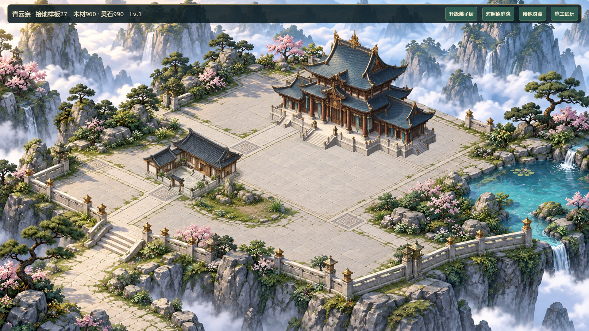
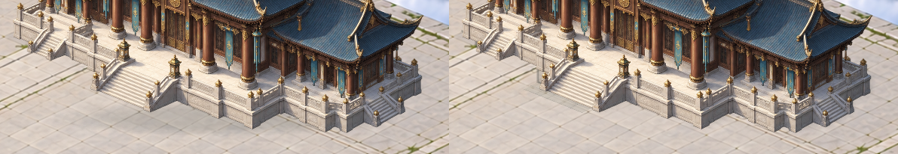

# V0.8 主殿接地修整27

2026-10-27，#37/#38，基线066a396。负责人在候选26实图诊断后明确“开始修整”，批准主殿台阶外一圈铺装、接触暗部与统一投影的局部修正。V0.7为最新已验收版本；本轮不计候选26或V0.8验收。

## 研究和实施计划

原样板在`scripts/samples/hall_courtyard_map.gd`以脚点处的扁椭圆表示整栋建筑影子。主殿原图1280×1280，落地轮廓包含多处台阶和台基转折；椭圆不能表达这些接触关系。候选26实际截图仍显示清晰台基边缘与较弱的外部接触影。

沿用已批准的原建筑和局部样板：按原图台基下缘描点，映射到原绘制矩形，在建筑前绘制接触暗部及左上光对应的右下柔和投影；门前只做窄小石板过渡，避免大面积素色底板。复用Godot绘制，不新生成背景或改原图，不增加依赖。原庭院25/园林26对照保留，另提供27接地修正开关作同状态对照。

拟改文件：样板地图和工具栏、新专项及GPU审图脚本、本报告、原启动器、TASKS/AI_HANDOFF/CHANGELOG必要摘要与当前画布。普通候选24、建筑素材/显示脚点/比例、GameState/SaveManager、原成本/工期、建筑身份/逻辑格、12×8/104×52/version3均不变。沿用当前任务分支，不另建worktree或重复台账，不推送。

- [x] 专项先验证缺失修正的失败，再检查双尺寸映射、建筑命中和状态不变。
- [x] 实现主殿轮廓投影/接触暗部和窄门前铺装；截图对照，只保留通过目视检查的效果。
- [x] 运行原快速回归，双尺寸GPU前后图和施工/升级/选中检查。
- [x] 测试结束后串行Windows导出、隔离图形启动；展示画布并更新交接。Windows有环境证书错误，正式档哈希不可比，限制见下。

停止条件：出现明显新底板、投影反向、入口遮挡或建筑位置漂移则修正/撤回对应效果，不用加景物掩盖问题。两尺寸实际截图与技术检查分开，负责人判断融合效果；不推广全图、不进入V0.9。

## 验证结果

新专项先红：缺少轮廓接地处理，退出1；实施后绿。最终71项快速回归PASS，0失败、无超时，退出0，日志`builds/local-validation/20261027-124413/`。原成本/工期、旧档迁移与恢复等回归保留，30分钟真实稳定性未跑。

本机受限进程无法读取Windows系统根证书库，原始启动报`Failed to read the root certificate store`。测试/GPU审图期间临时使用根目录`override.cfg`指定本机已有Git证书包，try/finally删除；未修改项目正式配置、验证脚本的错误判定、全局证书或引入依赖。71快测和最终GPU日志均无ERROR；初轮含证书错误的绿测不计干净通过。临时配置已核对不存在，Windows导出前已撤除，不随包交付。

GPU新专项生成双尺寸6张全图与2张原尺寸细节对照：720p变化6689像素、1080p变化15081像素，主殿区域外变化均0；这个统计只验证可见且局部，不是审美分数。另复用原实际主入口审图生成双尺寸16张，含两栋选中/卡片、空院、付费施工和升级。两个审图均退出0、PASS、无ERROR。日志`builds/contact27-check/gpu.*`、`entry-gpu.*`。已查看1080p细节左右对照和720p全景/主殿卡；接触变化细微，不宣称整体建筑背景融合已经解决。

首次Windows导出失败：受限进程无法访问用户Godot模板/缓存。改用仓库内既有4.7.2模板及隔离APPDATA/LOCALAPPDATA后串行导出退出0，生成`builds/QingYunSect-v0.8-contact27-win64.exe`（168206384字节）。但导出和样板/普通/付费施工/全景/自由建造五入口图形启动日志仍各有系统证书库ERROR；五入口均正常退出0，样板有OpenGL及明确隔离入口标记，无脚本错误。**Windows仅记录已生成/已启动，不计无错误验证通过。** 原始与隔离导出日志及五入口日志均保留于`builds/contact27-check/`，不隐藏环境错误。

所有回归与五入口试玩均隔离存档；样板继续不调用正式存读档。本会话没有枚举到正式`savegame.json*`，前后哈希文件未产生，故**正式档哈希比较未验证**，不把空结果声称为文件不变。没有真人鼠标试玩、独立代码审查、联机、真实长稳或负责人验收。

## 查看及回退

双击根目录`Run-Hall-Courtyard-Sample.cmd`打开27样板；“接地对照”在同一园林/建筑等级下开关本轮处理，“对照原庭院”保留25/26底图对照。原26和普通24包保留，不需存档迁移。普通游戏不启用本轮修整。

当前画布展示修整前、修整后与左前右后细节截图；截图为实际渲染，非新增生成资产。运行表现由项目原创Godot几何绘制，沿用原建筑/背景来源与许可，没有新增第三方美术。局部观察改善有限，整个庭院仍有大面积铺装与背景细节差异，留给后续视觉判断，不用本轮技术回归代替人工验收。

包SHA256：`5C8E85D9D0BE37F582D38DAA0AED2499628E89A733CFBC0537A29E6B071C2332`。

源码未提交/未推送，#37/#38仍待验收。向#37追加证据时工具返回`user rejected MCP tool call`，未向#38重复尝试；本轮GitHub证据及Project同步为欠账，不声称已同步。
