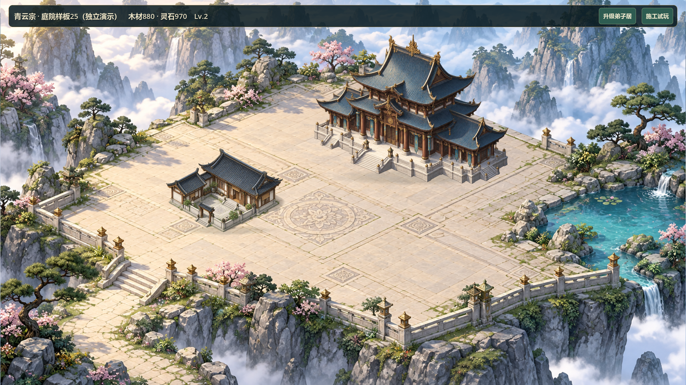

# V0.8 主殿＋庭院独立样板25

2026-10-26，关联#37/#38。此前交接已记录独立样板获准试做；本轮负责人明确“按需安装然后开始优化”。这不是全图推广或视觉验收。

## 设计与范围

现状：候选24有多处背景补丁，主殿较小，建筑与地面材质/细节存在反差；负责人认为仍与渲染图差距很大。本轮制作后殿—前庭—一侧翼连续空间，原主殿和弟子居素材保持独立可点选，青灰瓦、暖木、米灰石、低饱和松绿、左上柔光，近景清楚、远山退淡。

采用独立实机场景而非继续修补普通全景：样板内重新组织展示位置和比例，配套无建筑地形；主殿自带石阶之外不堆第二组大楼梯。入口石路和台基共面，边缘景观不遮住核心选择。具体展示坐标是本轮实施选择，不声称负责人逐项确认。相比迁移三维引擎，不触及稳定玩法；相比扩展全图，先让一块代表性场景可检验。

## 实施清单

- [x] 系统安装器下载三项原文，固定05ad7c8a5b8aa2aa86bbd3439ae7cf7295cac418；适配为studio-art-direction、studio-asset-spec、studio-visual-slice。原文/MIT/NOTICE/哈希保留，无钩子、全局服务或角色运行时。
- [x] 制作无建筑地形，配原主殿/弟子居透明素材，记录完整提示词、实际尺寸和来源。
- [x] 新建独立地图/控制脚本及场景；主场景仅增加显式入口，正常启动不变。
- [x] 专项验证双尺寸拾取、关闭/切换、原成本工期施工和升级，绘制不改变状态，正式存档隔离。
- [x] 原有68项及新增专项共69项快速回归、GPU实图、Windows导出/启动；局部候选交付，人工视觉验收未进行。

影响：新场景、新脚本、新背景及显式启动参数；不改GameState/SaveManager、12×8/104×52、旧ID/逻辑格、原成本工期、version3或普通固定院落。独立样板不加载/保存玩家档；回退只需启动普通入口。新场景可在导出包独立运行，不以概念图代替。

## 验证记录

基线bba134f（远端游戏基线142f94a）。最终69项快速回归PASS、0失败、无超时、退出0，包含旧档/恢复与8小时模拟；日志`builds/local-validation/20261026-122939/`。专项验证实际地图点击信号到卡片、关闭按钮、双尺寸边缘、纯绘制不改状态、原建设/升级价格与完成时间、重复操作不重复扣资源、ID/格坐标不变和仅重置演示基线。

专项先红（缺少独立场景，退出1）后绿。后续发现升级卡片沿用初建价格，新增价格负测退出1后改为查询原升级配置，最终全量重跑。负向拾取夹具最初落在实际脚手架后梁内部，打印凸包与坐标确认后改为空白区域，未改游戏迎合错误夹具。技能哈希清单初次枚举为空，已修正为显式6文件检查并通过，不把空清单算成功。

GPU在真实主场景入口携带`--hall-courtyard-sample`启动，确认普通主场景在读档前退出、独立场景接管；1280×720/1920×1080共16张实际图，覆盖完工、两栋卡片与轮廓、空场、施工、升级及完成，退出0/PASS/无错误，绘制前后状态相同。证据`builds/local-validation/hall25-gpu-final.*`和`builds/v08-scene-audit/hall25-*.png`；已查看两尺寸全景与卡片。审图脚本暂停时间后会显式刷新UI，避免旧时间文字混入完成截图。

首次受限环境导入有编辑器Safe save权限错误，有权限重跑后无错误，未关闭安全保存设置。仅新背景开启mipmaps，实际输出1672×941、3319141字节，SHA256 `47332A8AC29FA6AD23AC129C086B03CB7857D3829724D60A4F1E22873931509C`。来源/完整内置ImageGen提示词在`assets/environment/HALL_COURTYARD25.md`；原始两栋建筑未修改。

最终Windows串行导出PASS，样板/普通/原付费施工/原全景/自由建造备份五入口以图形模式独立启动并退出0、无错误；每入口隔离APPDATA。样板日志明确`formal save not loaded or saved`且未生成正式savegame.json。正式玩家`savegame.json*`部署前与本轮结束后的名称、大小和SHA256一致。日志`builds/local-validation/hall25-export-final.*`、`hall25-smoke/`。

## 打开与实际画面

双击根目录`Run-Hall-Courtyard-Sample.cmd`。默认展示仅在演示内扣原成本并推进完工时间的样板；点击“施工试玩”只恢复演示基线，再按“建设弟子居”，等待原6秒建设；完工后按钮执行原升级。点击两栋建筑查看卡片，点关闭/空白或Esc取消选择。不加载/保存正式档，退出演示不持久化。本轮普通游戏及旧两个启动器仍保留候选24。

包`builds/QingYunSect-v0.8-hall25-win64.exe`，162888376字节；SHA256 `DAF563E2D02AE12CCC26F5CC2C80FC2E5314457DCC8FABBAF5FE0A0F39FB343A`。

卡片和施工证据：`docs/art/v08-hall25-card.png`、`v08-hall25-construction.png`。不是生成概念图。

## 已知问题与停止点

- 前庭仍偏空，整体偏暖，建筑与远景细节密度仍需负责人比较；未宣称达到参考图品质。
- 独立松石试放出现孤立摆件、压栏杆及悬崖落点问题，最终撤下，当前只保留背景原有边缘景观。**独立前景遮挡尚未完成验证**，不能算本轮通过。
- 地形仍为烘焙背景，非精确三维共面；没有人物活动、分层云雾或其他六院落推广，建筑等级仍共用原图。
- 没有真人鼠标试玩、独立代码审查、联机或30分钟真实长稳；自动模拟点击和GPU输出不等于人工体验。
- #37/#38评论6408428324/6408429489已同步，保持open/TESTED；Project未另行同步。源码本地提交，未推送；构建/缓存/日志/存档不入库。

停在局部候选供负责人判断透视、比例、接地和材质方向。先解决本样板的空间/材质与前景落地问题，再考虑推广；不自动扩展全图或进入V0.9。
