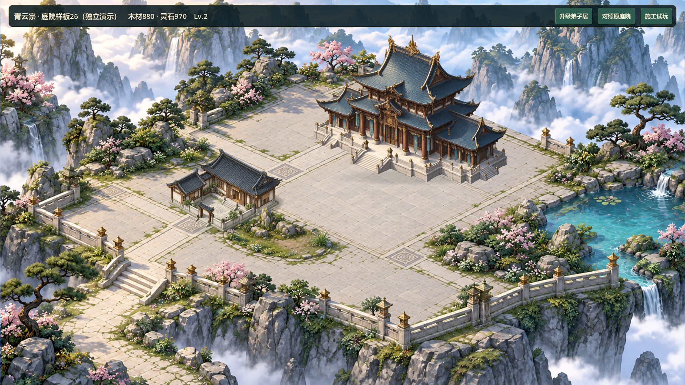

# V0.8 主殿庭院园林候选26

2026-10-26，#37/#38。负责人在候选25交付后明确“可以，继续优化”；只继续局部迭代，不记录候选25或V0.8验收，不推广全图。基线b9e97fe，远端未新增提交，本地领先3个提交且工作区干净；历史已验收版本V0.7。

## 设计与实施计划

目标：保留主殿与弟子居显示脚点/比例，缩减大面积空铺装，明确入口—侧翼—主殿的石路；在前庭平地制作有植床承托的独立低矮花石，验证前后遮挡。材质偏中性灰石和低饱和松绿，避免继续增加细碎亮绿斑点。原建筑、主殿台阶、外栏杆和远山云海不作重画。

采用候选25底图的非破坏编辑，新增候选26背景及独立透明景观素材；不用旧松石强行压在栏杆/崖壁。两栋建筑预留区不种植，主殿入口(890,415)、侧翼入口(493,552)保持通畅。低矮花石目标植床约Rect(610,610,185,65)，位于平地和栏杆内，具体落点须由实际截图复核，不以提示词当成坐标已经精确满足。

- [x] 底图编辑并检查实际输出、建筑预留区与石路；记录完整提示词/来源。
- [x] 制作透明花石；按真实alpha裁定显示框/底部脚点，接入样板独立前景层。景观无占地、逻辑命中或存档字段。
- [x] 增加同状态背景/前景开关供审图；原入口、资源、工期、升级和卡片继续沿用。普通候选24和现有25可执行包保留。
- [x] 新专项验证透明/前景框、入口不遮挡、查询不改状态、双尺寸建筑点击；GPU对照检查前景盖住建筑底角但不挡门，旧69项继续回归。
- [x] Windows串行导出与独立图形启动，提供新图/局部证据；更新原样板启动器到新本地包。

改动限`scripts/samples/hall_courtyard_map.gd`、样板标题、两张新资产及导入、专项测试/审图、启动器和交接资料。GameState、SaveManager、逻辑网格、存档/旧ID/坐标、成本/工期和普通地图不改。回到普通入口或旧25包即可对照，不需要存档迁移。

## 验证与限制

最终70项快速回归PASS、0失败、无超时、退出0；日志`builds/local-validation/20261026-153324/`，包含原69项、旧档/恢复/8小时模拟。新专项先红（缺少园林/前景，退出1）后绿，验证真实透明、两个入口不被景观框覆盖、双尺寸独立选择、对照按钮、显示框和游戏状态不变。未修改原成本、工期或存档来满足测试。

GPU两尺寸16张实际图加1张左右对照，覆盖原底图、新地面、加前景、卡片、空场、施工、升级和完工。`builds/local-validation/garden26-gpu-final.*`退出0、PASS、无错误。前景开/关分别变化5190/5192个有效采样，其中两尺寸均有150个不透明建筑重叠采样发生可见变化，证明该局部前景在建筑之后绘制；这是采样数量，不是全像素覆盖统计或审美评分。已查看1920全景、1280全景/卡片，入口及栏杆未见上一轮松石交叉。

首轮审图脚本Vector2/Vector2i相乘导致解析错误，随后RGB/RGBA对照拼接报错，已分别修正类型/格式并完整重跑。未把中途exit0/PASS且含ERROR的日志算通过。本机Python缺Pillow，改用Godot只读检查alpha，未新增依赖。

背景1672×941，3354460字节，SHA256 `68B0FF85825E9DA536D0E95C4328869C1579A6A4DF6BB776D67374FBA6847659`；前景1536×1024，2024867字节，SHA256 `96751E2C635C5364C2881DF0743D5DE0CEDA9EFB4DE897782A908FC85F091D58`。两图均内置ImageGen，原文件复制不修图，来源/完整提示词/实测alpha脚点在`assets/environment/HALL_GARDEN26.md`。植床实际更靠上，落点校准为(670,590)，不是提示词自动精确定位。

最终Windows串行导出PASS；样板/普通/付费施工/全景/自由建造备份五入口均图形模式隔离APPDATA启动并正常退出0，无错误。样板明确不加载/保存正式档，隔离目录未创建正式savegame.json；正式玩家`savegame.json*`与本日部署前的名称/大小/哈希一致。证据`builds/local-validation/garden26-export.*`、`garden26-smoke/`。

包：`builds/QingYunSect-v0.8-garden26-win64.exe`，168141824字节；SHA256 `A7C7DF0764DCCF766E0518611A2554DD16D7B6A4D7067062EBD877E5D1E0A201`。

## 怎么打开

双击根目录`Run-Hall-Courtyard-Sample.cmd`，已指向26包。默认仍为演示内扣原成本后推进完工时间的展示；“施工试玩”恢复独立演示基线，随后按原资源/工期建设和升级。“对照原庭院”只切换背景和景观，同一建筑等级/资源/显示坐标不变。原25包及普通24包均保留，普通入口不应用本轮园林。

卡片证据`docs/art/v08-garden26-card.png`；同状态左右对照`docs/art/v08-garden26-comparison.png`。都是实机渲染，非概念图。

## 尚未验证与停止点

- 地形仍为烘焙背景，独立前景只验证这一处局部遮挡，不代表全场景精确三维共面。
- 新背景编辑延续远景构图，但不保证生成图在目标之外逐像素不变；石路、建筑投影和整体密度仍须负责人比较。前景有半透明绿色地面晕染，缩小时可读性通过本轮查看，审美仍待判断。
- 没有新增人物活动、分层云雾、其他院落或玩法，没有真人鼠标试玩、独立代码审查、联机或30分钟真实长稳。
- #37/#38评论6410857891/6410859156已同步，仍open/TESTED；Project未另行同步。源码仅本地提交，未推送，构建/缓存/日志/存档不入库。

停在局部供负责人判断接地、空间秩序和密度，不自动推广全图或进入V0.9。
