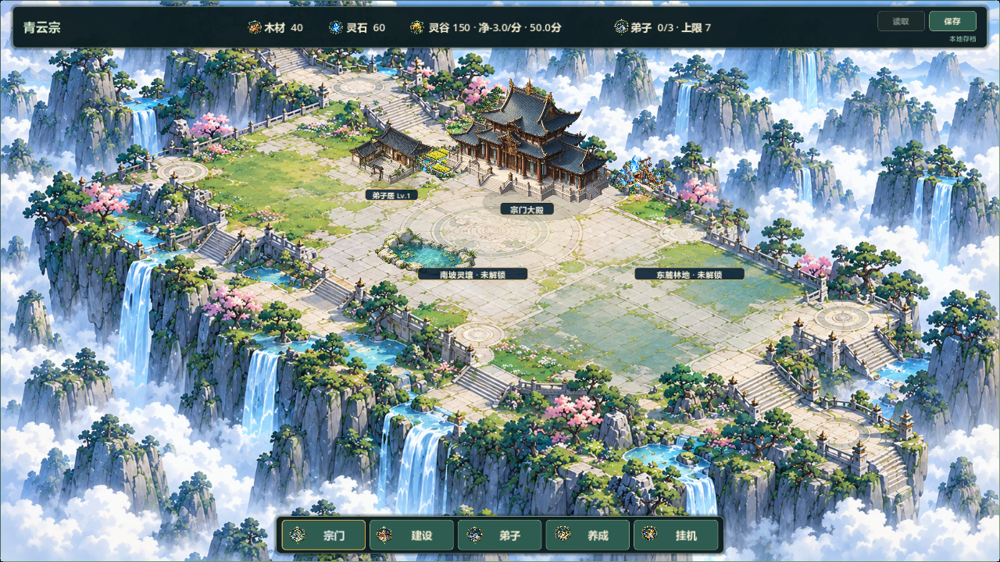
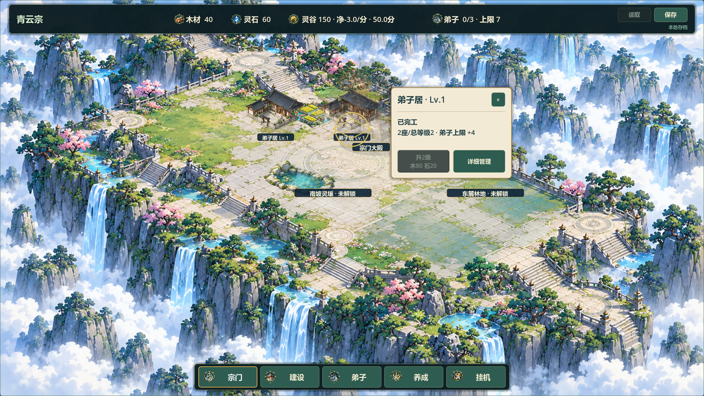

# V0.8视觉整改：阶段0与局部样板候选1

日期2026-10-20，任务#36/#37/#38。负责人已给出新的完整任务书，并明确“开始开发”；扩图补充回答为“后续开发能方便扩展地图（先做可扩展配置）”。本报告使用新的阶段0/1/2/3，不与历史七步记录混为一谈。

## 阶段0：核对结果

- 仓库https://github.com/C-destiny/QingYunSect.git；执行git fetch origin --prune成功，GitHub默认分支为docs/development-management（e936491），main为b7ca7fa，V0.8功能远端45b35b3。
- 工作分支feature/v0.8-visual-polish，实施起点dce1be9，包含V0.8远端与本地9次增量，已核对祖先关系/提交差异；因此沿用该基线，没有切换、重置、合并或推送。两项原未跟踪文件docs/LOCAL_ENV_SETUP.md、tests/run_all_tests.sh保持。
- 历史已验收V0.7；V0.8仍待验收。重新读取GitHub #36/#37/#38全文与评论，均open/TESTED、0评论。新任务书以本轮会话为最新范围；本轮证据未写回Issue/看板，另一台电脑工作区尚未核实。
- 已读取任务书、仓库AGENTS、规划相关版本/工程规则、任务/交接/变更、SAVE_FORMAT及旧参考图。当前参考为docs/art/v08-scene-reference.png；没有收到另一份更新参考文件，不把旧16×12讨论稿当新实施依据。
- 网格/区域配置在territory_catalog.gd；主殿固定规则仍在GameState.is_cell_occupied；绘制、深度排序、alpha命中与建造在sect_map.gd；详情与操作在main.gd；JSON版本3及1/2兼容在save_manager.gd。当前地图没有相机拖动/缩放，本轮不冒称已实现。
- 风险：全屏烘焙底图不适合任意扩区；屋顶拾取可能吞掉后方旧建筑；小卡会有边缘遮挡和点击穿透风险。处理仅限投影抽取、局部地景和建筑卡，不重写数据层或切换三维引擎。

## 阶段1：已编码范围

- 新sect_projection.gd集中104×52正反投影与主殿固定视觉坐标，反向命中接受地图边界。区域目录推导MAP_SIZE，地图不再额外硬编码宽高。当前配置仍core/east/south、12×8与原解锁价格/顺序；扩图是开发配置能力，不是新增无限地图或玩家扩图按钮。
- 后续新增区域时，修改REGIONS及有序REGION_IDS，范围自动推导；稳定旧坐标，补足新区域环境与旧档默认解锁/校验测试。未知区域ID仍严格拒绝，不能通过放宽存档校验实现扩图。背景目前仍烘焙为单张，扩展视觉还需要新分块素材及镜头支持，因此不是仅改数值即可完成全流程扩图。
- 主殿、台基/台阶、脚点与右下接地影沿用原样板，主殿逻辑仍(4,3)，林/矿/田与所有玩家建筑坐标不动。前庭通路只作低对比地面表现；新山石池水绘于地面层，不加入占地/交互集合，后建建筑可以正常覆盖其视觉。
- 真实点击主殿/建筑打开宣纸信息卡：名称、等级、状态、汇总效果、升级条件/成本及详细管理。复用原升级/保存入口，复杂管理仍按模块打开原抽屉。卡片优先在建筑侧面，窗口边缘翻转/限位；支持关闭、Esc、切换选择、建造前收起；卡片本身消费鼠标输入。
- 原建筑地面格优先于主殿屋顶，保持被遮挡建筑可选择；悬停/选中时沿用主殿透显。普通状态不隔着主殿绘制后方完工建筑标签，选中/悬停仍显示。
- 新池水由内置ImageGen生成，1619×971透明PNG，运行230×138；来源、提示词及哈希见assets/environment/HALL_GARDEN_POND.md，最终资源在项目内，没有引用Codex目录作为运行依赖。原程序平池水因材质不匹配已替换。
- 演示入口：Windows包添加用户参数--visual-sample，main在首次has_save前改用user://v08_hall_visual_demo.json，不读取正式savegame.json；独立演示生成(3,3)旧遮挡案例与(1,5)独立侧翼，停止演示自动保存，手动保存也只写演示路径。普通启动不添加任何示例建筑。

## 兼容与实现限制

没有修改GameState、SaveManager或SAVE_VERSION，没有新增持久化字段。建筑身份、逻辑坐标、等级、计时、资源、装备、岗位和奖励逻辑不迁移、不重置。地图装饰不影响96格原合法性；道路/池水不变成新禁建。

仍有明显差距：底图环境大多烘焙，未成为逐物件交互世界；原(3,3)位置会被主殿遮挡，只能通过透显与地面选择保留操作，不能迁位掩盖；池水与地面笔触/接缝和前庭层次仍需负责人视觉判断；未制作三套建筑等级造型；当前没有多格新占地、相机拖动/缩放或真实无限扩区。没有推广其他六类建筑。

## 验证记录

初版投影别名Projection与Godot内置类型重名导致解析失败，已改名SectProjectionData；初版主殿屋顶抢选旧格失败，已调整选择顺序；上述失败均已复测，不把初次启动当通过。

52组快速test_*.gd最终退出0/PASS且无SCRIPT ERROR、Parse Error、Assertion failed、ERROR或CRASH，每项45秒超时；30分钟真实长稳1项未重跑。最后选择状态同步调整后，卡片、弟子居生命周期与原UI三项又通过。新增卡片测试包含12×8/32×24投影往返、只读状态、小卡两窗口边缘/不遮选中建筑、关闭/详细管理/Esc/建造模式、主殿实际地图点击、升级意图及透明角。32×24是数学测试边界，生产地图未扩。

旧存档迁移/往返、错误输入及恢复、领地、资源、装备、战斗等沿用既有快速回归；弟子居专项仍完整核对升级中version 3往返与原坐标。所有测试使用隔离APPDATA和合成测试路径，不读取正式玩家存档。

图形命令：Godot --path . --log-file builds/local-validation/sample1-capture.log -s res://tests/audit_v08_scene.gd；45秒超时控制，生成1280×720和1920×1080共38张实际截图，检查退出0/PASS/错误日志，目视查看普通、建造、主殿卡与建筑卡。截图库sample1-*.png位于builds/v08-scene-audit。夹具内侧翼/生命周期实例仅在测试状态，不写玩家存档。

对照旧参考：青蓝云海、青黑瓦、暖木白石基调保持；独立侧翼与主殿形成主次、池水形成局部边界，宣纸小卡减少管理遮挡；透视/接地和整体空场仍有差距，不能称全图视觉完成。阶段1候选待负责人验收，停止扩展；修改意见继续限定在本样板。

未执行：人工鼠标试玩、双机/联机、30分钟真实长稳。本轮图形夹具是可视运行与模拟交互证据，不等同负责人验收。

## 交付与停止点

Windows候选包builds/QingYunSect-v0.8-hall-sample1-win64.exe，124360256字节，SHA-256 483142CDB2955AA9DAB4352F1FB3E69003AA3B8758B3A1B8B9583B0F31FEEAE6。隔离APPDATA下普通和--visual-sample两种入口独立无头启动退出0、无错误，演示日志确认2栋建筑且未读正式存档；无头包启动不代替人工试玩。

演示启动器builds/Run-Hall-Sample-Demo.cmd仅用于本地交付：调用同目录EXE并追加-- --visual-sample。普通EXE仍正常游戏入口；演示手动保存只写独立demo文件，不把预置建筑送入正式进度。源码/构建未上传。

导出命令：Godot --headless --path . --export-release 'Windows Desktop' builds/QingYunSect-v0.8-hall-sample1-win64.exe --log-file builds/local-validation/sample1-export.log，退出0/无错误。包启动--headless --quit-after 5 --log-file <path>，演示额外追加-- --visual-sample。日志sample1-package-normal.log、sample1-package-demo.log；最后全部52组快速回归又重跑通过，1项长稳未跑。新增脚本/图像导入成功，git diff --check通过。

当前阶段1候选已具备可运行、可点击与验证证据，停在局部等待负责人验收；本报告不宣称全部视觉整改完成或版本已验收。若负责人提出修改，继续局部迭代，不自动进入全图推广。
