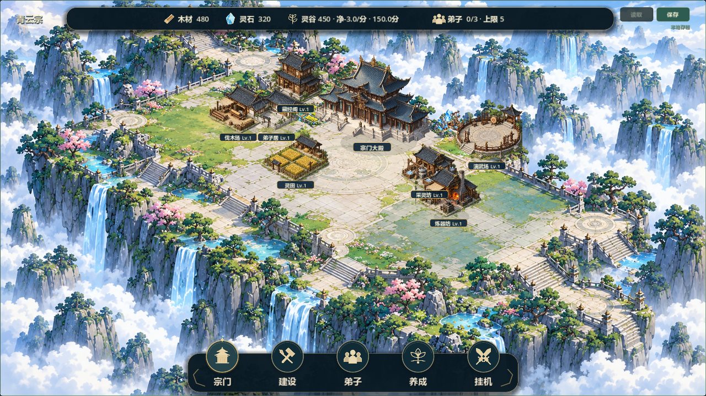
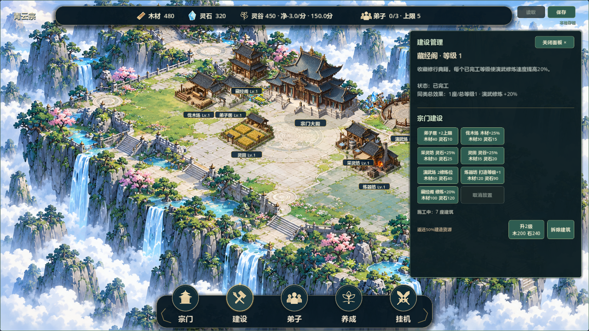

# V0.8 上下菜单候选5

日期2026-10-20，关联#36，阶段2待负责人验收。基线798e593，feature/v0.8-visual-polish。已核对Issue全文/评论、本地规划/任务/存档边界；git fetch默认权限受限，提权重试成功。原两份未跟踪文件保留，另一台电脑未核对，未推送。

## 实现与参考对照

用户前两张图为现状、最后两张图为方向。顶部去除通栏方框，采用独立暗玉资源条、细金边与柔影，两侧保留宗门名及保存/读取。木材/晶石/稻穗/弟子使用清晰原创SVG符号，避免旧图集缩小后的繁杂轮廓。

底部按参考改为圆形徽章、独立下方文字、暗色托板、金边与柔影；保留宗门/建设/弟子/养成/挂机五入口，没有新增参考图的其他入口。支持悬停、按下位移、键盘焦点与模块active高亮；焦点随打开模块移动。底栏约150逻辑像素，抽屉底距与建筑卡安全区避让同步。顶部仍不超过82逻辑像素。

scripts/ui/hud_symbols.gd集中原创矢量路径，正常运行栅格化为128像素透明纹理；hud_emblem_button负责徽章/文字/交互状态，hud_plate负责条板与侧饰，hud_styling接入原按钮。符号是简化矢量风格，并非参考图的手绘写实图标。没有外部素材/字体/依赖，没有截取参考图作纹理。旧图集保留供历史来源与原有资源检查。

固定主殿、12×8、104×52、自由建造、资源规则、原分类与关闭流程、version3存档不变，无迁移。

## 验证与修正

- Godot4.7.2调试引擎53项快速回归均退出0/PASS/无错误，各45秒超时，日志builds/local-validation/hud5-test_*.log。UI检查覆盖五入口、重复点击/按钮关闭、双尺寸文字边界及新组件/高度，新增active状态；卡片检查新增不与底栏相交。
- 实际截图发现宗门旧focus与建设active同时高亮，已修正焦点跟随。首个发行包发现SVG加载误写assert内、release跳过导致空图；已移出断言为正式步骤并检查返回值，弃用该产物。两次小修后UI/卡片2项再跑通过，日志hud5-final-test_v08_visual_ui.log、hud5-final-test_sample_building_card.log；不把先前53项称为最后小修后的全量复测。
- 最终实际图形运行双尺寸1280×720/1920×1080，共32图：正常、七建造预览、七卡片、建设面板；退出0/PASS/无错误，日志hud5-capture-final.log。目视检查正常1280、炼器卡1920及建设面板1280，对照参考暗玉/金边/圆形入口和下方文字层次，主场景仍可读。最后SVG改动仅将相同加载从assert移出，不改变调试截图效果。
- 最终串行Windows导出退出0无错误，隔离APPDATA普通/七建筑独立演示两入口启动PASS无错误，日志hud5-export-final.log、hud5-package-normal/demo.log。发行包用于启动验证，不替代调试断言。无头启动与模拟按钮不等于真人鼠标试玩。
- git diff --check通过。未执行真人、联机、双机及30分钟真实长稳。地图构图、独立等级造型、资源点调色等遗留未标记完成。

## 交付

builds/QingYunSect-v0.8-hud5-win64.exe，126423216字节，SHA256 **461EE6472388243F355B855B5431A566CC2A71F4C21385B288F128AE9A9B7EE2**。

双击builds/Run-Full-Scene-Demo.cmd进入本包独立演示，使用user://v08_full_visual_demo.json，与正式存档分离；旧候选4保留。已同步[#36评论](https://github.com/C-destiny/QingYunSect/issues/36#issuecomment-6289490437)，Issue保持open待验收，Project镜像未同步。不推送源码、不关闭Issue/里程碑，不进入V0.9。

