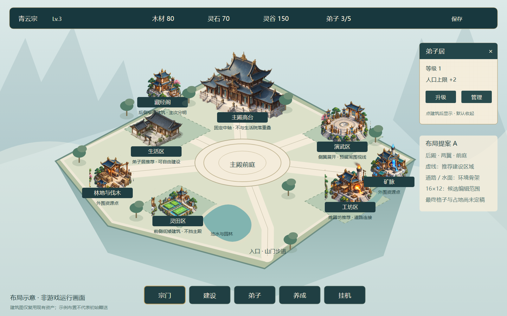

# V0.8 宗门布局重排提案 A

> 历史讨论稿。已被负责人随后给出的完整视觉整改任务书替代：本轮保留12×8、固定主殿及旧位置，不执行本稿16×12或迁移建议。当前实施见V0.8_HALL_SAMPLE_REMEDIATION.md。

日期：2026-10-20。关联 #36（UI）、#37（地图）、#38（建筑）。状态：布局讨论稿，未接入运行时，非功能验收。

## 本次授权

负责人明确提出“不必强行保持原有设定，如有更好的想法随时提出，我们讨论确定”，随后同意“先采用第一种，完成一张布局草案，讨论确定后再落地”。因此地图尺寸与旧坐标不再是设计讨论的绝对限制；本轮授权是制作可审阅草案，具体数据迁移、规则调整仍需结合草案讨论确定。不能把这次“可以”当成V0.8验收。

历史已验收V0.7，目标仍V0.8。当前feature/v0.8-visual-polish，起点e9ee542，本地领先远端跟踪8次提交；两项无关未跟踪文件保持。已重新读取GitHub #36/#37全文及评论，均open/TESTED、无新增验收。远端正文仍保留旧坐标约束，本次会话的新决策优先；本轮讨论稿尚未同步至Issue/看板，另一台电脑未确认同步。

## 要解决的问题

第六阶段实际画面仍有大片空石坪；主殿、资源点与旧弟子居扎堆上方，建筑遮挡通过透明化缓解但构图问题没有解决。通栏HUD与整高抽屉缺少主次，不足以达到负责人参考图的视觉完成度。继续仅缩小控件不能解决这些问题。

## 推荐空间结构

1. 主殿后置于中央高台，前方圆形广场和台阶形成清楚的中轴。主殿仍是视觉焦点，不被普通院落屋顶挤占。
2. 左侧生活院落、后侧藏经阁；右侧演武场与较低的工坊；前侧灵田和入口园林。外围配置松林与矿脉，资源点的位置随构图重排。
3. 台地间采用窄石路、短阶和低栏杆；边缘通过池水、松石、花木和云海收口，避免连续铺满屏幕的大矩形石坪。
4. 这些是推荐布置与一份发展中宗门示例，不把所有建筑免费送给新档；功能区默认仍是软分区，不新增按类型限制的强制规则。
5. 探索16×12的编辑范围，给建筑轮廓、道路和园林留空间；这不是把每块空白都变成可建格，也不是已经批准的地图参数。初版保留2:1等距与104×52基准，若实际尺寸不合适再讨论镜头缩放，不同时重做全部标尺。

## UI方向

- 顶部短资源条，宗门名/等级、三资源、人口各自成组，深青玉石、细暗金线、米白字。净收益与缺粮详情放二级提示，关键异常仍有醒目标记。
- 底部五入口保留名称与图标，独立悬浮，有明确当前模块状态，避免所有入口都是同样醒目的大绿框。
- 点建筑优先打开小型宣纸信息卡：名称、等级、效果、升级/管理；关闭在卡片标题内。复杂弟子、养成、挂机页面仍需要按需打开的可滚动管理面板，不能把复杂内容全塞入小卡。
- 常态不显示整图格子；建造模式显示可建范围、占地预览及原因。1280×720与1920×1080分别检查文字、可点范围与遮挡。
- 示意图中的数值仅是排版样例，设置按钮、装饰人物等只代表视觉方向；不得将它们描述为本轮新增已实现功能。

## 保留的经营语义

本方案优先保留三资源、七建筑及等级效果、招募/岗位/培养、装备、挂机战斗、现有价格/收益公式和离线收益。地图扩展不自动批准新建筑、新资源、新玩法、强制功能分区或数值调整。

建造容量需要单独核对：如果道路/固定广场不可建，必须证明各解锁状态下新可建容量足以容纳对应旧档的全部建筑；不能只验证几个稀疏样例。建筑真实多格占地暂不进入首轮，以免把美术重排变为整套建造规则重写；可后续另议。

## 旧档迁移方案（设计要求，尚未编码）

当前外层SAVE_VERSION=3，旧建筑保存cell_x/y，GameState仍硬编码主殿(4,3)。若新旧坐标含义变化，建议引入显式布局版本或外层version 4，并继续接受1/2/3；选型在编码前确认，禁止用version 3静默改写原坐标含义。

- 迁移由数据层执行，先完整验证旧档，再在内存中生成新布局；按稳定instance_id建立映射，优先在同解锁区域安排，冲突时采用固定顺序的最近合法位置。软分区只提供建议，不按建筑类型强制搬进某区。
- 建筑ID、类型、等级、施工/升级剩余时间、人口、库存、角色装备、岗位、战斗、离线计时、已领取目标与解锁状态保持；不额外发奖或重复离线结算，不扣迁移费用。
- 先验证各解锁状态的满图容量。若不能无损安置全部建筑，方案必须调整，不能丢弃建筑、自动拆除、自动解锁、清档或仅迁移一部分。
- 在原子写入与备份机制上增加迁移前原版保留；迁移失败保持原文件与原内存，提供明确原因。重复读取/保存不得重复移动建筑或改变ID。
- 迁移后旧程序可能不能读取新格式，应保留迁移前备份与旧预览包以回退，不能笼统承诺双向兼容。
- 覆盖version 1/2/3、空档、满档、仅core/core+east/全解锁、施工升级中、装备/战斗中、损坏输入、保存失败回滚及往返幂等测试；测试禁止访问正式玩家存档。

## 实施顺序与讨论点

先确认这张草案的中轴、左右区与UI方向；再把16×12和道路占地转成可验证布局配置，完成容量验证与迁移设计；通过后替换样板环境并重排主殿/资源点，接着实现信息卡与管理页层级。每步都提供游戏实际渲染与参考对照；草案图不能替代可运行场景。

当前仅交付设计稿与实施边界，运行时代码、玩家存档、现有坐标、地图尺寸和Windows包均未更改；本轮不需要重复运行历史功能测试或导出相同EXE。待讨论：是否采用中轴山门布局、是否接受16×12作为首轮验证候选、宣纸小卡是否符合期望。

## 布局示意与本轮验证

示意图由tools/draw_layout_proposal.py以自绘矢量地形/道路和既有项目建筑素材编排，通过隔离Edge无头进程渲染；不是Godot运行截图，不是最终环境美术，也没有把新方案接入游戏。内置ImageGen尝试生成视觉草案时连接失败，未生成可交付新AI图片，未使用CLI/API替代。

图像1600×1000，SHA-256 5C7D93B2C58E5262D2FBEC68B2F71652716BF6BEF43A8F324AE8396325B5B384。脚本Python语法、SVG XML解析、PNG文件头/尺寸检查通过；人工查看导出图，修正矿脉标牌与右侧说明重叠、树冠遮挡注记后重新导出。Edge渲染退出0；日志包含浏览器自身QQBrowser导入路径/任务管理器诊断，PNG已实际生成并查看，未将其当Godot错误或游戏验证。

本轮无游戏编码、迁移实现、自动回归、人工试玩、Windows游戏导出或联机测试；旧预览包仍为阶段6。下一步需要负责人对本图空间方向提出修改或确认，随后细化容量/坐标与迁移方案，不能直接把示意像素当成存档格子坐标。
