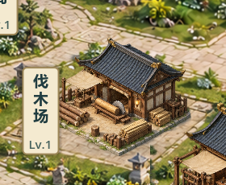
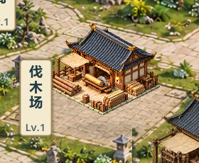

# V0.8 伐木场单栋接地样板20

2026-10-23，关联Issue #38，TESTED/open待负责人视觉验收。负责人同意先试单栋，不代表候选19验收，也不授权六联图集全部重绘。

## 实际范围

- ImageGen按用户图集方案生成伐木场单栋，并做一次留白/接地编辑。原六联图集未覆盖，其他五类图集建筑、独立主殿和弟子居保持。
- 新图独立存放`assets/buildings/lumber-contact20.png`，1024×1024、真实Alpha。原生成两稿都为1254×1254，未精确遵守留白，故仅做Godot等比缩放和透明画布归一化；没有用Python重绘。
- 非透明范围(138,121)～(873,814)，四周至少10%透明边。显示区域Rect2(102,102,820,820)，整图脚点(0.5,0.8)换算后使用，避免安全留白导致建筑显得缩小；实际世界脚点仍由原固定布局决定。
- 通过统一`get_building_visual`接入绘制、预览、alpha拾取与选中轮廓；`lumber_contact_sample=false`可恢复原图对照。该开关不存档，不改变建设成本、工期、效果或实例身份/坐标。
- 来源、原图缓存、完整两轮提示词与处理记录见`assets/buildings/LUMBER_CONTACT20.md`；归一化工具`tests/prepare_lumber_asset.gd`只用于开发，不进入导出。

## 看图与试玩

原图实机：

新版实机，同状态/同尺寸：

双击`Run-Courtyard-Preview.cmd`打开七院落独立展示，不读取正式档。

包`builds/QingYunSect-v0.8-lumber20-win64.exe`，151061952字节；SHA256 `78B9C28279F629AD1D7B9B20C7A9D88C0C7495CA79700C17E8F9A109D42DD252`。不入Git，另一电脑需导出或单独复制包。

## 验证

- 新单栋路由回归先对旧图集失败exit1；接入后通过。覆盖Alpha、留白、内部区域、脚点、透明/不透明拾取、开关对照、其他建筑保持及查询不改变GameState。
- 最终64项快速回归全部PASS/退出0/无错误，`builds/local-validation/20261023-114015/`，含两组8小时模拟。前次64通过后调整显示区域，以上最终版本已全量重跑。
- `builds/lumber20-capture-final.log`：GPU两尺寸1280×720、1920×1080，8张整场景和4张局部裁切，前后同状态、描边与管理卡。初稿审图跨尺寸残留卡片，已修复隐藏后重拍，以最终截图为准。
- Windows快测结束后串行导出无错误，普通/付费演示/完整展示/自由建造备份四入口隔离APPDATA启动exit0/无错误；`builds/lumber20-smoke/`。无正式玩家档访问。
- `git diff --check`通过；没有核心公式、GameState、SaveManager、存档version3、建筑ID、逻辑格或资源成本变更。
- 未真人鼠标试玩、30分钟真实长稳、联机或另一电脑验证；未提交/推送。技术检查不等于美术验收。

## 已知问题与验收

新版比旧版更亮、更暖，石台仍有明显轮廓，未证明比旧版更融洽；没有宣称完成投影精确统一、软边融合或六建筑重烤。请负责人按实际尺寸判断：色温是否接受、体量是否合适、底座是否仍像贴片、轮廓/点击是否正常。认可单栋后才讨论其余五栋；不直接推广，也不进入V0.9。
