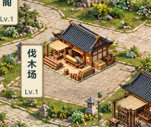
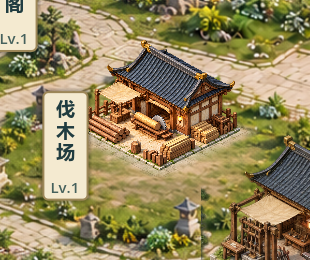

# V0.8 伐木场地面几何校准 — 候选21

2026-10-23；关联Issue #37/#38，TESTED / 待负责人视觉验收。负责人指出建筑台基和背景方框方向冲突后明确“再次修改”；不记候选20或V0.8已验收。

## 本轮改动

1. 清掉伐木场旧铺装及方框，保留周边园林/道路。生成底图只取300×160局部羽化窗口，不覆盖全图。
2. 以独立伐木场不透明石台左/前/右三点推导两组地面轴，把现有俯视石材纹理映射为紧凑院坪。移除相互交叉的双层方框，而非旋转整栋建筑或改色遮掩。
3. 建筑图、脚点和拾取不变，地面边缘淡出至草地。其余院落不推广。新运行开关`lumber_ground_alignment`默认true，只作旧背景同状态对照，不持久化。

修改范围：`scripts/world/planar_courtyard_sample.gd`、`scripts/world/sect_map.gd`、新背景素材与来源记录、专项测试/截图脚本、预览入口及必要交接文档。无GameState、SaveManager、数据目录、场景、公式或project.godot变更。原ID/逻辑格/等级/资源/version3不变。

## 实机对照

以下是同一建筑/存档状态下的实际1920×1080局部截图，不是AI效果图。

修改前：

修改后：

完整实机图：`docs/art/v08-lumber21-context.png`。仍有其他院落方向、全局贴图锐度/比例和材质差异，本轮不能证明全图融合已解决。

## 验证证据

- 新`test_lumber_ground_alignment.gd`：对旧实现先失败exit1（旧烘焙矩形），实现后双尺寸地面轴与手工读点平行、前沿包围/距离、整栋不倾斜检查PASS。初版测试调用静态脚本反射报解析错，改为脚本实例后才取得有效红测，不把解析错算红测。
- 65项快速回归PASS/退出0/无错误：`builds/local-validation/20261023-120557/`，含旧档迁移/存档恢复/8小时模拟。30分钟真实稳定性测试未运行。
- GPU双尺寸1280×720、1920×1080：各4整图+4局部，共16张，同状态before/after、选中、管理卡。`builds/lumber21-capture.log`，真实像素变化834/820；其他三个院落取样点变化0，未声称全图逐像素比较。
- `git diff -- scripts/core scripts/data scenes project.godot export_presets.cfg`为空；既有未提交修改保留。
- 测试停止后串行Windows导出无错误：`builds/lumber21-export.log`。普通、付费演示、七院落展示、自由建造备份四入口隔离APPDATA启动退出0无错误；展示日志明确formal save not loaded。发布包不作断言测试。
- 包：`builds/QingYunSect-v0.8-lumber21-win64.exe`，153558696字节，SHA256 `AC35F80C4A30FB5EFF10BA6DED78847A6D3BAE15599F0157224D87A57ACEA047`。

## 如何查看 / 待验收

双击项目根目录`Run-Courtyard-Preview.cmd`，打开独立七院落展示，不读取正式玩家存档。关闭此前旧版窗口后重新打开，重点看伐木场周边是否还有第二套歪斜方框、院坪与台基方向是否协调、草地过渡是否自然。普通入口仍需原资源和施工时间。

未进行真人鼠标试玩、真实30分钟长稳、联机或另一台电脑验证。当前只交付局部样板，需负责人确认后再决定推广范围。#37评论6357146925、#38评论6357148054已同步，保持open/TESTED；Project未同步。源码/构建未提交推送。
