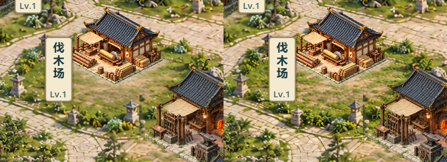

# V0.8 伐木场近景清晰度对照 — 候选24

2026-10-24，关联#37/#38，TESTED / 待视觉验收。负责人反馈“背景有点糊，建筑太精致”，同意先做一块近景样板；不记22/23或V0.8已验收。

## 本轮范围

以建筑为材质参照，重做伐木场周围原330×220区域为1536×1024局部素材，映射回原位置；石材、草丛、灯座更明确。建筑本身、瓦片/木纹/金边不改，远山云雾保持，先单独判断背景细节密度改善。没有全图推广。

新增非持久化`near_material_sample`默认true，关闭可同状态回看原背景。`Planar.draw_background`最后混入局部素材，台基、阴影、建筑、施工架、选中和UI仍沿原顺序绘制。路径/草丛细节随生成有变化，不声称局部形状完全锁定。

初稿缩到实机有碎噪点，最终新图启用mipmaps并使用线性缩小过滤；未用整体模糊建筑的方法补救。现有素材均未开启mips，1920关闭新样板的整图与过滤改动前RGB逐像素一致（只读ImageChops检查，未用Python改图）。

## 原生实机对照

左为原版，右为新近景，同一建筑/数据状态：

完整实机：`docs/art/v08-material24-context.png`；局部：`docs/art/v08-material24-after.png`。新石路与草丛较清楚，但略偏亮偏黄绿，与未处理周边仍有差别。是否降低贴纸感需要负责人判断，自动测试不是审美验收。

## 工程与验证

- 修改`sect_map.gd`、`planar_courtyard_sample.gd`及新素材导入；新增参考裁取、专项回归、GPU审图脚本。更新预览/施工入口和必要交接。
- 建筑两PNG哈希保持原样：lumber-contact20为8938FE5D…，原六联图集为D971A224…；未触及核心、数据、场景、project.godot及导出预设，无玩法/资源/工期/ID/逻辑格/version3变化。
- 有效红测两次：旧实现未接入局部近景、新高分图缺缩小过滤，均退出1；实现后检查素材密度、mips/采样、所有建筑及施工几何/拾取不变、游戏数据不变。
- 最终68项快测PASS/退出0/无错误：`builds/local-validation/20261024-002621/`，含旧档/恢复/8小时模拟；真实30分钟稳定性测试未运行。
- 最终GPU双尺寸16张before/after/选中/卡片与原生局部，再加1张左右对照。`builds/material24-capture-final.log`：区域内变化1625/1630采样，区域外每5物理像素网格检查变化0，非区域外全像素扫描。原生1920/1280局部及全景已目视。
- 最终Windows测试后串行导出：`builds/material24-export.log`退出0无错误；普通、付费演示、七院落展示、自由建造备份四入口隔离APPDATA启动PASS，`builds/material24-smoke/`；展示明确formal save not loaded，发布包不作断言测试。
- 包：`builds/QingYunSect-v0.8-material24-win64.exe`，159684512字节，SHA256 `C169FCD814DD92F21E66DC7567E00E2C4FB2B4035660B49D26767EDADA2B1200`。

## 打开 / 下一步

关闭旧窗口，双击根目录`Run-Courtyard-Preview.cmd`查看已完工全景，重点比较伐木场周边与其他未改院落；`Run-Construction-Test.cmd`同样已指向24包，可按原资源/工期建设。两者均是已有隔离演示模式，不读取正式档。旧construction23包保留，可直接打开同一展示模式作旧版参照。

先等负责人判断：近景清晰度是否足够、草地是否过碎/偏亮、边界是否可察觉、建筑是否仍显独立贴图。未批准前不推广其他院落，不扩大改建筑/玩法。

来源/完整提示词见`assets/environment/NEAR_MATERIAL24.md`，内置ImageGen一稿，无API/CLI回退。参考提取脚本在编辑工程内使用，有“直接载入PNG不适用于导出”的引擎提示；该工具不进入发布包运行，不将其当发布测试。

#37评论6369714085、#38评论6369716853已同步，保持open/TESTED，Project未同步。无真人鼠标/真实30分钟长稳/联机/另一电脑验证，源码与构建未提交推送，原未提交工作保留。
