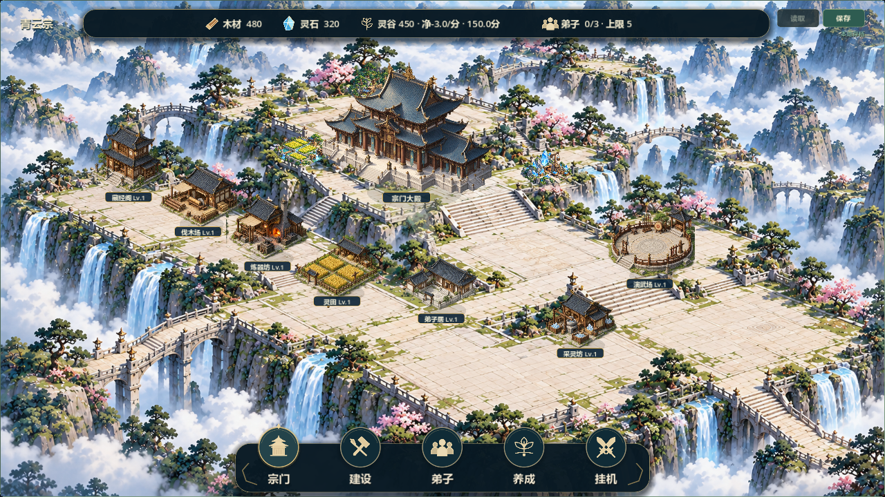
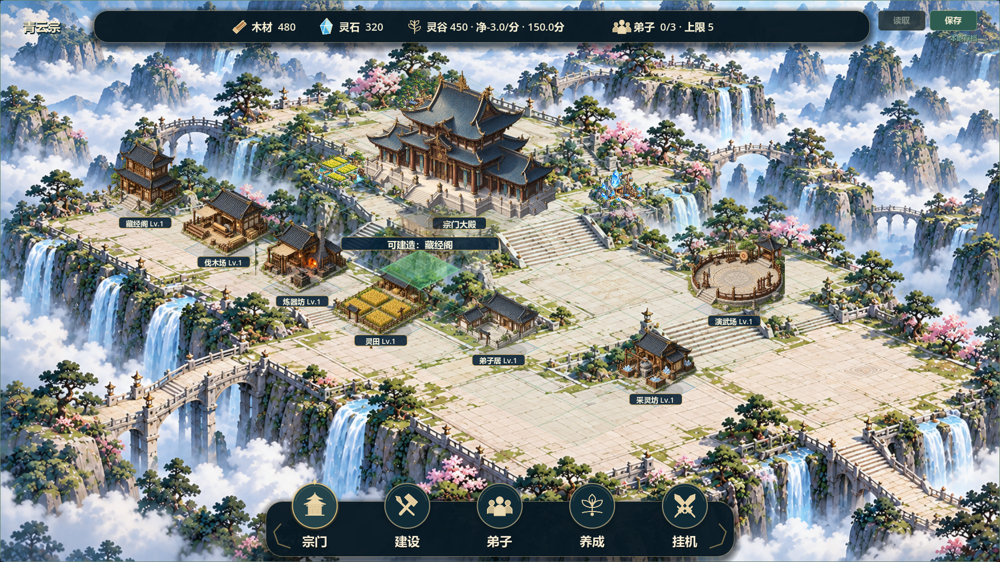

# V0.8 开阔宗门场景方案与候选6

2026-10-20，关联#37/#38。负责人最新要求：“地图我感觉还是很狭小，没有开旷的感觉，以这个场景为目标继续修改方案进行开发”。阶段1已验收，当前阶段2持续改进，不将本次开发授权当作全图验收。基线fe4e80e、feature/v0.8-visual-polish；已重读任务/规划/存档边界与Issue全文/评论，git fetch成功。保留原两份未跟踪文件，未直接核对另一台电脑，未推送源码。

## 问题与修改方案

上一版背景虽宽，功能建筑仍集中在靠后的狭窄带状区域，地形主要是一块平整沙盘。新参考的开阔感来自后殿抬高、两翼分散、前庭深入、台阶连接、远峰桥梁与云海纵深，不是简单增加地图格数。

本轮批准范围内采用：

1. 从单块平平台转为后部主殿、两翼台地、宽阔前庭与远景山峰的构图，低细节建筑落点与园林边缘分开。
2. 将逻辑投影与视觉间距进一步分离。104×52、12×8及主殿(4,3)保持，渲染地面间距独立×1.45，建筑不同比放大，让通路与庭院有空隙；主殿仅本体330→390逻辑像素强化主次。
3. 格线、锁区外轮廓、建筑/资源脚点、建造预览、小卡位置均使用同一渲染映射，点击先逆变换再解释原逻辑格。不是把逻辑地块换成参考中的其他尺寸。
4. 只调整独立演示的推荐摆位验证新场景；真实玩家建筑继续使用原instance_id/type/cell/level，不改存档，不按功能强制分区。
5. 先验证开阔方向，再继续逐格地形衔接与局部细化；不增加真实区域、资源、玩法、移动建筑或大型技术迁移。

## 本轮已实现

- 新背景assets/environment/sect_open_terraces.png通过内置ImageGen按最新参考生成：多层石台、宽阶、远桥、瀑布和云海，功能建筑/人物/UI未烘焙进背景。1672×941、3674565字节，来源/提示词/哈希见assets/environment/OPEN_TERRACES.md。旧背景保留，未覆盖。
- scripts/world/sect_scene_layout.gd集中管理1.45视觉间距、画布构图原点与可逆变换，底层sect_projection.gd的104×52不变。sect_map使用配置同步地面/格线/锁区外轮廓/命中，主殿视觉比例调整，原排序与功能保留。
- visual_demo仅显式--full-scene-demo/测试使用，七种样例放在不同台地验证主次和留白。普通启动不调用它；此处改示例坐标不是迁移真实存档。
- 沿用候选5上下菜单及原卡片/升级/管理交互。未引入任何持久化字段或新依赖。

## 验证证据

- 原53项快速回归均PASS/退出0/无错误，日志builds/local-validation/open6-final-test_*.log，各45秒超时。覆盖旧档1/2/3、原建筑/资源/领地/经营/战斗及UI流程。
- 新test_open_scene_layout第一次错误地把1280物理窗口当作地图逻辑画布，使边界断言失败并超时终止。项目以1920画布缩放至1280窗口，夹具已修正为实际逻辑画布及更大画布；最终单独重跑PASS/退出0/无错误，日志open6-final-layout-clicks.log。新增96格及内部偏移正反映射、合法格模拟点击落点、104×52/12×8/固定主殿、1.45视觉步距和状态不变检查。因此是“原53项＋修正后的新1项通过”，不是首轮54项全部通过。
- test_full_scene_visuals的池水双候选冲突夹具随纯渲染间距调整测试摆位，原七类三级/全部合法格/完整version3往返保留。生产GameState与SaveManager未改。
- 双尺寸1280×720/1920×1080实际运行32图，含正常、七类预览、七类卡片、建设抽屉，退出0/PASS/无错误，日志open6-capture.log。另有快速正常画面夹具audit_v08_open_scene.gd。截图open6-*，精选docs/art/v08-open6-normal.png及v08-open6-preview.png。已目视对照两尺寸正常图与1920预览：台地层次、建筑间距、前庭与远桥改善，主殿仍是视觉中心；这不是静态概念图代替游戏。
- Windows串行导出退出0且无错误；隔离APPDATA普通与七建筑演示入口启动均PASS，日志open6-export.log、open6-package-normal/demo.log。未以发行包执行断言测试。
- git diff --check通过。未人工鼠标试玩、联机、双机同步或30分钟真实长稳。截图与模拟输入不代替负责人验收。

## 候选包与存档

builds/QingYunSect-v0.8-open6-win64.exe，129061240字节，SHA256 **9A00E4C66D186BB057FCF8BB92B2A53E411876BE862CC40B3696007143DE2B95**。

Run-Full-Scene-Demo.cmd已指向候选6，隔离user://v08_full_visual_demo.json；普通EXE继续原存档流程。视觉坐标变化不写回cell字段，无重置/迁移/免费补送，不减少原合法格。未来真实扩图仍需单独区域配置与兼容验证，本轮不是无限地图。

已同步[#37](https://github.com/C-destiny/QingYunSect/issues/37#issuecomment-6290274354)、[#38](https://github.com/C-destiny/QingYunSect/issues/38#issuecomment-6290275373)，保持open待验收，Project镜像未同步。源码/构建未上传。

## 明确剩余事项

地形、阶梯、桥梁、栏杆仍为烘焙背景，不是可逐物件交互的三维地形；少量合法边缘格和园林/栏杆/台阶视觉接缝仍需校准，当前没有按图片判禁建或迁移旧建筑。资源点仍比新建筑鲜艳，人物行走、等级独立造型、镜头缩放拖动未实现。

下一步先以本包确认空间开阔方向，再细化台地接地、资源点调色及密集旧档可读性；最后进入整体回归与负责人最终验收。不把本轮标记为全图已验收，不进入V0.9。

