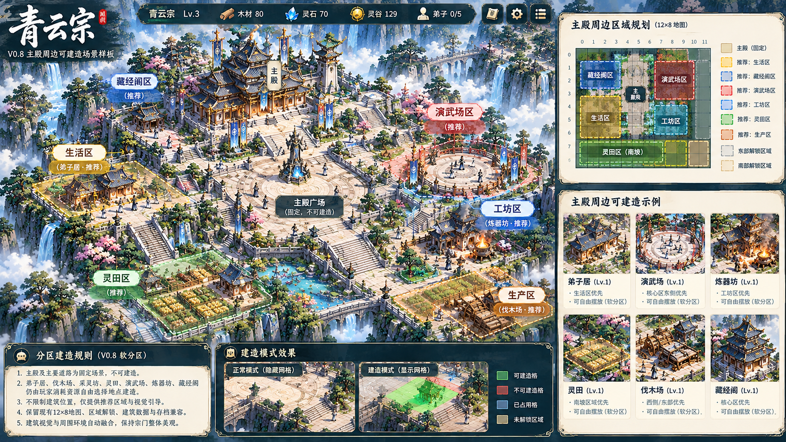
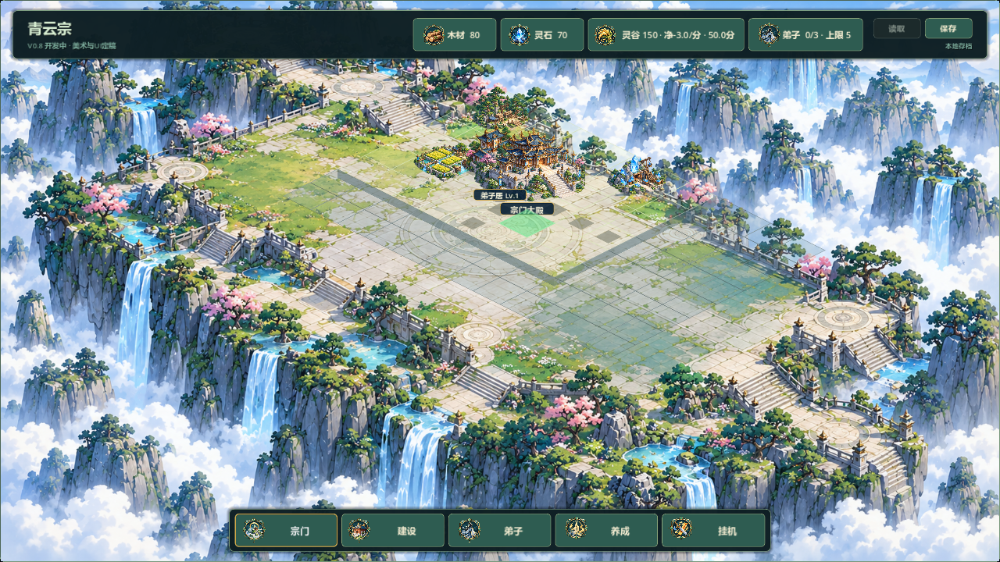

# V0.8 主殿周边2.5D场景样板：阶段1审计

日期：2026-10-19。关联QYS-V08-003（#37）、QYS-V08-004（#38），后续验证关联#41/#42。
状态：阶段1现状审计与运行基线已完成；场景视觉改造尚未实施。本报告不代表样板或V0.8已验收。

## 授权、工作区与边界

负责人本轮要求按附件七步顺序分阶段完成，每次与所附渲染图对照，主体基调一致而非逐像素复刻。附件定义的固定核心、软分区自由建造及坐标约束为本轮批准范围。

- 已验收版本V0.7；目标V0.8；本机分支feature/v0.8-visual-polish，起点4e08a9f，比本地远端跟踪分支领先2个提交。
- 本轮已重新读取GitHub #37/#38全文及评论（均0条），均为open / TESTED历史记录；新样板未被验收。未发送远端评论或修改Issue，新增阶段证据仅保存在本地，后续按负责人远端管理授权同步。
- 保留接手前未跟踪的docs/LOCAL_ENV_SETUP.md与tests/run_all_tests.sh。本轮未fetch源码、未直接检查另一台电脑，不把本地远端跟踪引用等同于实时双机同步。
- 12×8、104×52；主殿(4,3)、林(1,1)、矿(6,1)、田(2,4)；east/south范围、解锁顺序与价格、七建筑ID、实例坐标、数值与version 3字段不变。
- 阶段1只增加审计脚本、文档和参考/基线图；没有改运行时代码或存档格式，没有生成新AI素材或新Windows包。

## 参考与实际运行对照

参考图：

当前1280×720普通模式，真实Godot渲染，含通过实际建造入口生成的弟子居夹具(3,3)：

当前同视角建造模式，悬停(5,4)：

右侧规划板、底部说明卡、参考图资源数值与手绘建筑布局属于说明，不照搬为游戏HUD、数值或新逻辑坐标。参考图的树木和台地不直接成为阻挡区域。

| 对照项 | 参考图主体基调 | 当前可复现事实 | 本轮修正方向 |
|---|---|---|---|
| 主次中心 | 宏伟主殿、前广场、周边生活建筑逐层展开 | 主殿、三资源点和相邻弟子居挤在上方小范围；大部分画面为空石台 | 先统一投影与视觉基座，再以主殿样板建立中心；不靠扩大逻辑占地挤走旧建筑 |
| 地面 | 米白铺地、石阶、道路自然融合 | 96格逐格描边，半透明绿色菱形叠在已有石台底图上 | 正常模式不画完整网格，地面、道路与交互轮廓分离 |
| 建筑接地 | 同一台地上的主殿、生活院落 | 每张图集自带独立石台、植被或小山体；贴到另一张完整台地上形成拼贴 | 主殿/弟子居单独定义底座、脚点、右下阴影与环境过渡，不只调大贴图 |
| 透视和比例 | 左上光源、统一2.5D相机、普通建筑次于主殿 | 图集格整格缩放；缺每资产脚点、底座宽、透明边距说明 | 建立只用于渲染的资产契约，采用等比绘制并明确地面锚点 |
| 层级 | 按地面深度自然遮挡 | 建筑按GameState.buildings顺序画，随后一律画主殿、资源点 | 排序独立渲染列表，不排序/改写存档数组；遮挡与选择高亮分层 |
| 交互 | 建造时才显示清楚的合法/非法提示 | 普通/建造网格基本相同；仅悬停格红绿填充，无占用/锁区原因文字 | 预览层独立，提示文字由Godot绘制，复用现有合法性规则 |
| HUD | 克制的深青条框、场景主导 | 顶部全宽资源条、底部五入口，面板已按需显示 | 样板后期轻量压缩顶部高度，保留刚修好的分类及标题旁关闭 |

## 代码事实与问题定位

1. scripts/world/sect_map.gd 的_draw固定为：底图→所有tile→道路→buildings数组→主殿→资源点→预览。没有按脚点深度混合排序，建筑遮挡取决于创建/读档顺序。
2. _draw_backdrop把1672×941底图映射到实际1918×1078地图控件。16:9窗口下宽高比例基本一致，不能把目前问题直接归咎于明显非等比拉伸；但背景台地与104×52投影分别定义，缺统一地面锚点。
3. _draw_tile始终填充、绘制cliff和完整outline，未按placement_building区分模式。_draw_region_connections绘制缩小到0.48倍的独立菱形石板，容易形成叠在线上的道路观感。
4. _draw_environment_details定义了可按占用隐藏的松石绘制，但当前_draw没有调用；主要环境仍烘在背景，无法独立前后排序或按建筑位置避让。
5. 建筑图集1671×941，4×2分割得到417.75×470.5采样格；目标136×153比例约0.889，与来源约0.888接近，未证实明显压扁。真正缺口是每资产独立裁切、脚点与底座数据；分数像素边界也需在资产阶段确认边缘采样。
6. 地标图集1536×1024，2×2格768×512；主殿绘制224×149并上移64，资源点126×84并固定偏移。仅凭统一中心偏移无法保证独立院落/矿山/田块脚点一致。
7. _draw_building的统一圆形影子与图内独立石台不是同一基座形状；主殿图集分支直接return，无单独可调接地影子。当前不能宣称已满足参考图统一右下阴影。
8. _gui_input只通过_screen_to_cell的地面菱形找建筑；高屋顶的可见区域不一定能点击对应建筑。后续高建筑选取需以视觉轮廓与逻辑格明确分离，不能改占地换点击。
9. GameState.is_cell_occupied仅固定主殿(4,3)与已存建筑；地图另有资源格排除。软分区不能加入is_placement_valid、start_construction或生产倍率的硬限制。广场/道路保持装饰，不能让旧合法空格失效。
10. SaveManager仍为SAVE_VERSION=3，读1/2/3；GameState持有数据、主场景负责输入调度和渲染，审计不改保存/结算路径。

## 选择的最小改造方案

优先保留SectMap现有Control、GameState、SaveManager和信号；将绘制过程明确拆成远景、地面/道路、按脚点排序的建筑/地标/环境、前景、选择与预览。第一步不强制引入TileMapLayer或整体换成3D。

渲染数据只向现有GameState读取，不回写存档；资产的sourceRect、footAnchor、baseWidth、shadow属于视觉配置。软分区只给推荐标识，无禁建、无产量惩罚。后续人物若获准接入，复用脚点排序接口；本轮不声称已存在人物行走系统。

否决：整张参考图直接替换背景（无法交互/保存兼容）、放大所有贴图（会加剧遮挡且不能解决地面匹配）、重排建筑坐标（破坏旧档）、重写整个经营架构（不属于样板范围）。

## 阶段路线与每次渲染对照门槛

| 阶段 | 实施范围 | 同视角截图必查项 | 状态 |
|---|---|---|---|
| 1 现状审计 | 本报告、隔离渲染夹具、参考与基线 | 主殿/弟子居聚集、网格、地面脱节与参考差距逐项记录 | 已完成审计，非视觉达标 |
| 2 场景结构 | 局部绘制分层、脚点排序、正常/建造层接口 | 云海青蓝、暖木白石基调不漂移；排序不依赖建造顺序，所有原合法空格仍有效 | 未实施 |
| 3 主殿样板 | 主殿、白石广场、脚点、阴影与有限环境 | 主殿成为视觉中心；统一光源与石台衔接，不遮挡交互/不扩占地 | 未实施 |
| 4 弟子居样板 | 一套可建院落、施工、选择、升级与拆除表现 | 青瓦暖木、小于主殿；接地一致，测试同位置建筑生命周期及旧档 | 未实施 |
| 5 建造反馈 | 普通隐藏网格、悬停/占用/锁区提示 | 普通清爽、建造清楚；颜色加文字，非推荐区域仍合法 | 未实施 |
| 6 HUD轻量优化 | 顶部条高度、悬浮导航、面板避让 | 1280×720及1920×1080可读，标题旁关闭和五页分类不回退 | 未实施 |
| 7 样板交付 | 全量回归、前后图、Windows包与报告 | 正常/建造、主殿近景、两分辨率、同夹具前后图；等待负责人验收 | 未实施 |

每阶段都先看游戏真实渲染，再与本报告参考图比较：色温、主殿中心、建筑比例、地面融合、光影、遮挡和HUD各给出“改善/未改善/退化”及具体说明。不能用单纯像素相似度代替美术判断，也不能只提交AI概念图。

完成局部样板后才由负责人决定是否推广；其余六建筑按弟子居资产契约逐类接入，优先解决生产建筑的低矮比例，再推广演武场/炼器坊/藏经阁。当前只记录推广顺序，不重做全地图。

## 实际验证与复现

引擎C:/Tools/godot-4.7.2/Godot_v4.7.2-stable_win64_console.exe，Godot 4.7.2.stable.official.ed1daf0bf。渲染RTX 2060 / OpenGL 3.3 Compatibility。

命令（PowerShell，APPDATA设为项目builds/local-validation/scene-audit-appdata，不使用正式玩家目录）：

~~~powershell
& 'C:/Tools/godot-4.7.2/Godot_v4.7.2-stable_win64_console.exe' --path . --log-file builds/local-validation/scene-audit.log -s res://tests/audit_v08_scene.gd
~~~

- 外层进程超时45秒；实际退出0，有PASS，无SCRIPT ERROR / Parse Error / ERROR / Assertion failed / CRASH。
- 输出四张图：builds/v08-scene-audit/before-{normal,construction}-{1280x720,1920x1080}.png。
- map_size=(1918,1078)，hall_anchor=(1011,376.04)，panel_visible=false；两分辨率统一1920×1080逻辑投影。96格地面中心坐标正逆变换通过。
- 三资源点与主殿坐标由源代码核对；未挪坐标。弟子居通过start_construction与目录build_time推进生成，不直接伪造已完工记录；未保存夹具。
- 图集corner/upper_center/center三个采样点alpha均为0；底图三点均为1。仅能确认采样透明，不代表全部外轮廓无光晕，下一阶段仍需全轮廓检查。
- 相关6组回归：test_building_system、test_building_interaction、test_building_upgrades、test_territory_expansion、test_v06_to_v07_migration、test_v08_visual_ui；逐个Godot --headless --path . --log-file <独立日志> -s res://tests/<名称>.gd，均退出0、有PASS，错误扫描为空。
- Node辅助PNG检查因本项目无pngjs未执行，未新增依赖；改用Godot原生Image读取尺寸与alpha完成采样。
- 本阶段没有重跑48组全量、30分钟真实长稳，没有导出新EXE或人工鼠标试玩。原modules-rc包仍是上一轮成果，不含任何新场景改造。

## 来源与交付

- 参考图由负责人本轮提供，只作内部方向与对照；来源哈希CE90491E91F9BBF2E466BF1C46C7C0273DC869E6EB72E9111BA45DBBBABAA584。不将图中文字、UI或建筑布局作为运行资产。
- baseline两图来自本项目Godot实际渲染，不是AI改图。
- 新文件：本报告、tests/audit_v08_scene.gd、docs/art/v08-scene-reference.png、docs/art/v08-scene-baseline-normal.png、docs/art/v08-scene-baseline-construction.png。
- 未完成：阶段2～7的实际场景改造；当前的建筑聚集、地面融合和普通网格问题仍存在。本阶段没有申请或记录负责人视觉验收。

## 阶段2：绘制分层与脚点接口（2026-10-19）

- 已编码：SectMap显式远景、地面道路、接地影、按地面深度排序的建筑/地标、最终交互层；脚点使用归一化纹理坐标，与逻辑占地独立。没有更改12×8、104×52、任何实例坐标或version 3。
- 世界物件混合按x+y、x、稳定ID排序；不再把主殿和资源点无条件画在全部建筑之后。返回独立渲染列表，不重排GameState.buildings。标签、工人计数、施工进度和选择环最后绘制。
- 主殿/普通建筑/资源图集均通过明确脚点配置绘制，初始位置沿用基线；建筑等级缩放围绕脚点，避免底座漂移。此为接口，不代表新美术已校准。
- 新增test_scene_render_layers.gd：相反建造/数组顺序仍有同样绘制顺序，渲染不改导出数据，三个级别脚点不漂移，原合法空格/主殿/资源/锁区合法性保持。
- 实际测试：49组快速test_*.gd逐进程45秒超时，退出0、有PASS且无SCRIPT ERROR/Parse Error/ERROR/Assertion failed/CRASH，49通过、0失败；30分钟真实测试跳过。首次专项因预加载早于autoload导致编译失败，改为运行时load并补显式类型后重新通过，不把失败日志计入通过。
- 实际图形：隔离APPDATA运行audit_v08_scene.gd，退出0/PASS，无错误，两种分辨率四图写入builds/v08-scene-audit/stage2-*.png。原始before和docs/art基线均保留。

与参考/阶段1逐项对照：色温保持青蓝云海、米白地面和暖木，未退化；遮挡规则改善且弟子居标签不再被主殿覆盖；主殿中心感、比例、地面融合、统一光影尚未改善（未引入新素材）；常态网格和HUD尚未改善（分别留到阶段5/6）。没有把结构通过等同美术达标。环境独立资产和人物前后穿行尚未实现，现有背景仍烘焙大量环境；本阶段不声称已建立完整可交互2.5D世界。

修改文件scripts/world/sect_map.gd、tests/audit_v08_scene.gd、tests/test_scene_render_layers.gd及阶段文档/截图。没有新Windows包或负责人验收。

