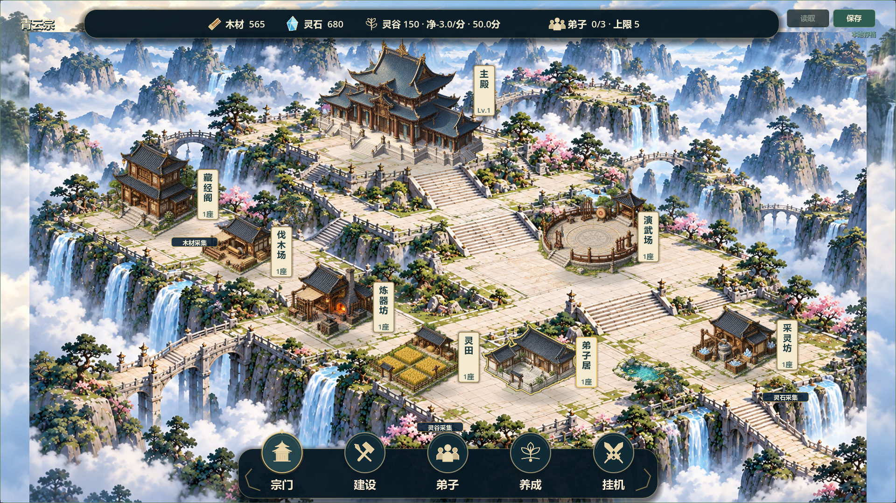
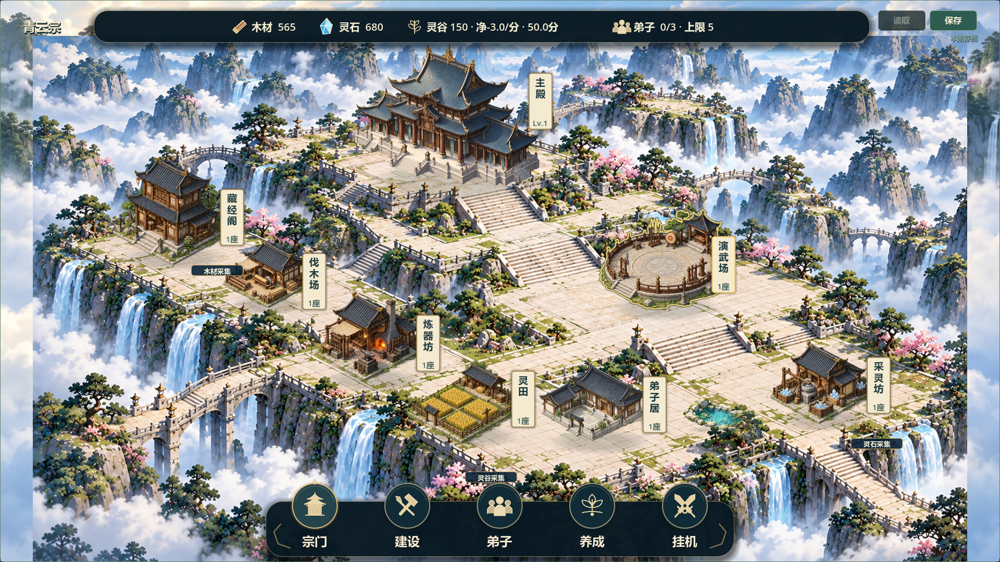

# V0.8 选中建筑轮廓候选13

2026-10-21。任务#37/#38，已测试/待负责人验收，保持open。负责人明确要求将底部选中圈改为整个建筑轮廓，本轮仅做该修正，没有开始此前建议的NPC/环境动画开发。历史已验收版本仍V0.7，V0.8候选12不因本轮请求视为验收。

基线ac1f126，feature/v0.8-visual-polish；已fetch origin，未切换/合并/推送，另一电脑未验证，原docs/LOCAL_ENV_SETUP.md和tests/run_all_tests.sh未跟踪文件保持。

## 实现

- building_selection_outline.gd读取素材alpha，以0.35阈值提取闭合轮廓，1.5原图像素简化，忽略零碎透明亮点，按贴图和图集区域缓存。描边跟随真实凹凸形状，覆盖屋檐、墙身与台基，不是矩形包围框或脚下圆圈。以2像素金线和4.5像素暗色衬边保持明亮地面上的辨识。
- fixed_sect_view.gd主殿和七类建筑绘制时按当前选择加轮廓，保持建筑及前景排序；取消原底圈和待建空地圈，未建设仅名称牌边缘突出，施工突出脚手架。
- sect_map.gd保留的自由建造备份同步使用完工建筑轮廓，取消建筑选中格框；资源及建造预览规则沿原逻辑。
- main.gd从主殿/实例管理进入时同步选中类型，卡片关闭、Esc或资源切换时清除旧选择。无玩法、成本、资源、建筑身份、坐标或version3变化，无新依赖和位图资产。

## 验证

- git diff --check通过。
- 5项相关调试回归均PASS/退出0/无错误：test_building_outline、test_fixed_layout、test_sample_building_card、test_scene_render_layers、test_v08_visual_ui。新增L形透明凹角测试排除退化矩形，八类建筑轮廓覆盖屋顶到台基、闭合/归一化/图集区域与缓存、不改变状态。日志builds/local-validation/outline13-test_*.log。
- 实际GPU（Godot4.7.2/OpenGL/RTX2060）1280×720、1920×1080共24图，包括主殿与七类选中、取消选择、待建、施工、自由建造备份主殿；outline13-capture.log PASS/退出0/无错误。已目视检查主殿、弟子居的屋檐和台基边缘。
- Windows导出通过，普通/付费演示/完整展示/备份四入口在隔离APPDATA下启动通过。包builds/QingYunSect-v0.8-outline13-win64.exe，140482376字节，SHA256：99A8BED6D7419EF04286D35E75AFBA7880A3867822A45B8BBAA47ADB2D50B5C6。两个固定演示启动器已更新到该包。
- 未全量回归、未真人鼠标试玩、联机或30分钟长稳；无头启动不代替人工验收。轮廓精度受原素材透明边缘与简化参数影响；待负责人确认线宽和颜色。

Issue追加记录：#37 comment-6314045753、#38 comment-6314047400；Project未同步，源码未推送，保持待负责人验收。
