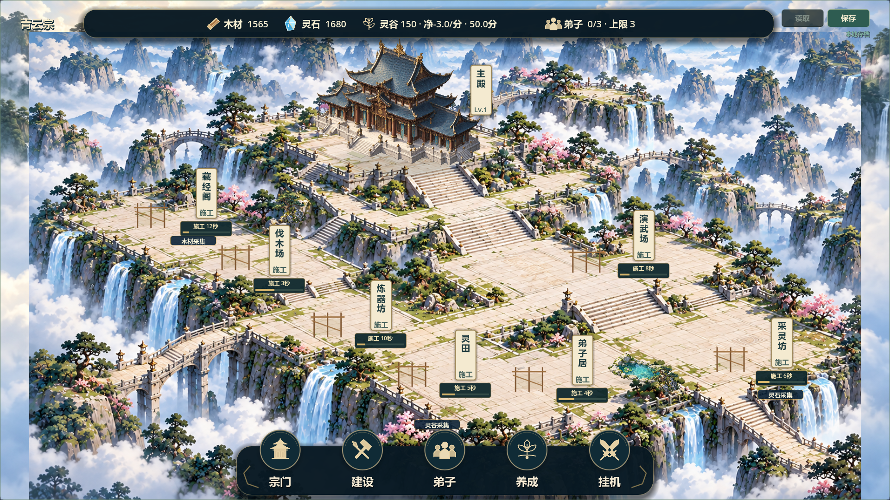
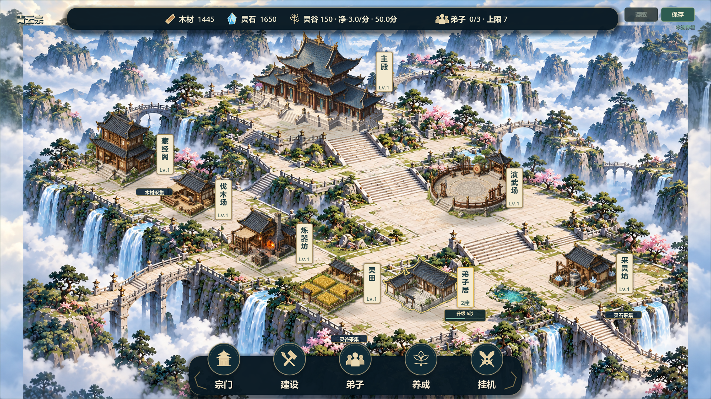

# V0.8 院落状态反馈候选14

2026-10-21，#37/#38，已测试/待负责人验收，保持open。负责人在三套技能适用性评估后明确“继续开发”，继续V0.8视觉/UI范围；不等于候选13或版本验收。历史已验收版本仍V0.7。没有安装第三方技能或启动引擎迁移。

## 核对与改动

基线202d653，feature/v0.8-visual-polish，fetch成功；另一电脑未验证，未切换/合并/推送。原未跟踪.workbuddy/、docs/GAME_COMPARISON_2026-10-21.md、docs/LOCAL_ENV_SETUP.md及tests/run_all_tests.sh保护不动，对比文档仅作未批准建议，不推进其玩法或V0.9。

核对固定场景发现施工与升级在地图上缺少进度反馈，因此本轮先完成该表现缺口，未继续扩展地形。新增scripts/world/fixed_site_feedback.gd，只读真实实例状态，提供名称牌状态、悬停摘要、施工/升级剩余秒数与进度。多项并行展示最早完成任务，同时间按实例ID稳定排序，并标总项数；完工自动移除进度牌，不把表现时间当成结算依据。

单个完工建筑显示真实等级，多实例保留座数并在悬停摘要说明完工数和最高等级；未完工实例不显示虚构Lv.0。进度牌可点击进入原院落卡，资源点点击和悬停保持优先；可操作区域手形，空白箭头，离开地图清理提示。全建筑轮廓选中保持。

表现约束：沿用青灰屋顶/暖木/米白纸牌，施工金色、升级青绿色；牌下附着短进度条，不另起大面板，不改变建筑脚点/台基/道路。首轮截图发现“施工中”三字拥挤，改为“施工”，时间在牌下显示。本轮没有新增位图或外部依赖。场景实际地形、人物及园林密度沿用原候选，不宣称融合整改全部完成。

建设成本、工期、资源、收益、升级公式、原建筑ID/类型/坐标/等级和version3均不改，无新增存档字段。测试/审图设置隔离路径，不打开玩家正式档。

## 验证

- 静态：git diff --check通过。
- 调试回归：8项最终PASS/退出0/无错误，逐项30秒超时；fixed_site_feedback、fixed_layout、building_outline、v08_visual_ui、sample_building_card、scene_render_layers、building_upgrades、save_manager。日志builds/local-validation/feedback14-final-test_*.log，汇总feedback14-test-results.json。
- 新测试使用失败计数和quit(1)，避免断言失败后等待外部超时；覆盖付费建设、原工期、并行最早完成、真实升级进度、完工撤牌、两尺寸命中/悬停、资源优先及查询不改变状态。
- 实际GPU：Godot4.7.2/OpenGL/RTX2060，两尺寸1280×720、1920×1080共14图，空场/施工/完工/并行扩建升级/卡片/单独升级/最终完成，feedback14-final-capture.log PASS/退出0/无错误；已目视核对施工、升级、两尺寸整体位置。
- Windows：导出及普通/付费演示/完整展示/自由建造备份四入口隔离APPDATA启动PASS。包builds/QingYunSect-v0.8-feedback14-win64.exe，140486744字节，SHA256：77CB273770471E53708BBB15ED22356B65B3A0A042D1A761B3560BCC7F7040F1。两个固定演示启动器已更新。

未重跑60项全量，未真人鼠标试玩、联机或30分钟真实长稳。截图为受控时间推进的实际运行图，不作为人物动画/自然运动录像证据；本轮未实现这些动画。进度牌字号与颜色需负责人体验确认，特别是小窗口下的可读性。地图图形仍为2D固定院落，烘焙地形和多人实例共用一个视觉模型的限制保持。

## 实际截图

待负责人验收地图进度、悬停摘要、点击切换及与纸牌风格的一致性；下一轮按反馈继续场景/动态表现，不擅自新增玩法。Issue追加记录#37 comment-6318034148、#38 comment-6318036743；Project未同步，源码未推送。
