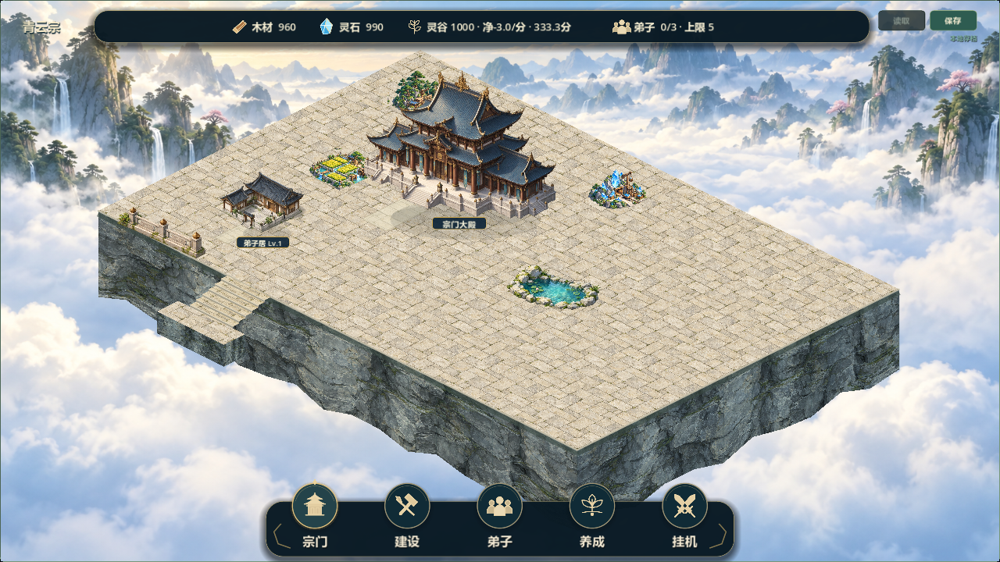

# 统一地形基准与逐件景观候选9

2026-10-21，关联#37（V08-003）、#38（V08-004），V0.8阶段2局部整改。负责人要求共用地形基准、平整接地后验证视觉高差、逐件截图、交叉时调整地形；**是继续实施授权，不作为候选8或整阶段验收**。

基线d70b840，feature/v0.8-visual-polish，本地领先远端17提交。已读取仓库指令、主规划铁律/协作边界、任务/交接/变更/存档说明及#37/#38正文、评论与阶段1验收记录；git fetch成功，远端仍45b35b3，默认仍docs/development-management/e936491。历史已验收V0.7，目标V0.8。未切换/合并/重置/推送；另一台电脑工作区未直接核对。原两份未跟踪文件保留。

## 改动

- sect_scene_layout.ground_frame从逻辑格和同一原点派生foot、rect、entrance、shadow。主殿/七建筑渲染与拾取、入口、接地影、详情卡及建造预览同步使用该结果。入口是归一化素材锚点：主殿(0.28,0.79)、弟子居(0.31,0.805)，屋顶/等级尺寸不影响逻辑占地。
- 地面、格线与反向点击继续共享_map_origin。visual_plane_lift默认0，只作整体共面视觉偏移验证；没有写回cell_x/y。可建区域保持平整，未实现内部区域高台或多层点击。
- 新增外沿六级台阶，每级视觉落差4，共24；位于合法地面边界之外。首轮截图出现无落台的悬挂感，补下端落台与岩壁承托后重新截图，不用搬建筑解决。构件仅视觉，不提供新可建格、通行或资源功能。
- 分阶段开关0地基、1入口与一段外沿阶、2一段栏杆、3一处池石园林。栏杆从两段缩为一段，并按实际等级建筑台基矩形让位；园林检查建筑、资源、入口与地面边界，候选冲突改位，两处都冲突则隐藏。入口与其他建筑冲突也隐藏；不增加占用规则。
- 新地形仍仅--courtyard-demo启用。普通入口、七建筑演示未推广新地形。演示一栋弟子居，独立v08_courtyard_visual_demo.json，正式存档不读取或覆盖。GameState、SaveManager及version3未改；12×8、104×52、主殿(4,3)、自由建造/软分区和原建筑身份/位置保留。

## 验证

- Godot 4.7.2.stable.official.ed1daf0bf。56项快速调试回归退出0、PASS且无ERROR，结果builds/local-validation/terrain9-test-results.json；含旧档迁移和往返、建造/领地/经营/战斗既有检查。
- 新test_terrain_baseline.gd覆盖两尺寸×两种平面标高×四阶段×96格，共1536次直接输入处理事件，校验原逻辑格及可建/不可建发出意图；七类三级脚点、入口、阴影、预览一致；纯查询不改游戏数据；园林因两处合法施工依次改位/隐藏。这里是程序事件测试，不是人工鼠标试玩。
- 最后将主殿拾取/卡片接入ground_frame时，三处Rect2自动推断失败；显式类型修复后，地形基准/局部融合/卡片三项最终复测PASS。日志terrain9-final-post-*.log。56项在该最后小调整前执行，不将失败日志称为通过。
- 双尺寸1280×720、1920×1080，四阶段、正常、侧翼卡、主殿卡、预览、抬高24，各9张，共18张最终图形运行截图；退出0/PASS/无错误，日志terrain9-delivery-capture.log。已目视检查四阶段、落台修正、最终主殿卡、预览和抬高效果。
- Windows导出退出0/无错误，APPDATA隔离普通/局部/七建筑三入口启动退出0/启动成功/无错误；日志terrain9-export.log、terrain9-package-*.log。发行包只作启动验证，未用其运行断言测试。
- 未执行人工鼠标试玩、双机/联机、30分钟真实长稳、玩家正式档人工检查。旧档证据来自隔离自动测试。

## 实际截图

| 顺序 | 内容 | 截图 |
|---|---|---|
| 0 | 平整地基 | [实际图](art/v08-terrain9-step0.png) |
| 1 | 入口、外沿台阶及承托落台 | [实际图](art/v08-terrain9-step1.png) |
| 2 | 一段外沿栏杆 | [实际图](art/v08-terrain9-step2.png) |
| 3 | 一处可让位园林 | [实际图](art/v08-terrain9-step3.png) |
| 映射 | 整体抬高24，仅验证 | [实际图](art/v08-terrain9-lift24.png) |
| 交互 | 建造预览、主殿卡 | [预览](art/v08-terrain9-preview.png)、[卡片](art/v08-terrain9-hall-card.png) |

## 打开与限制

双击builds/Run-Courtyard-Demo.cmd，指向QingYunSect-v0.8-terrain9-win64.exe -- --courtyard-demo。包136603776字节，SHA256 **E64FB84ED86A18C6CCDAD7DEEF64ECE7C68877B040C485ED7F1392CF75ED6E6A**。旧全图入口仍指向open6，不能当作本轮新地形。

场景仍是偏空的规则石台，铺装重复，台阶/承托需要进一步美术细化，资源点与屋顶邻接轮廓、自然外缘、前庭道路层级尚未完成。没有宣称达到参考图、所有旧位置人工融合通过或完整多层地形。默认可建区域不加高差，后续内部台地需要另行验证连续地面/过渡和反向命中。

本轮未引入新位图或外部素材；几何石阶/落台/入口为项目代码绘制，铺装、岩壁、栏杆、池石沿用ASSET_SOURCES与TERRAIN_LAYERS/COURTYARD_FUSION/HALL_GARDEN_POND记录。截图为实际Godot运行结果。

下一步按局部验收反馈，调整承托/入口材质、道路主次与自然边缘；逐件审图继续保持，不自动推广全图或推进V0.9。#37/#38已追加进展并保持open，Project镜像未同步，源码/构建未上传。
