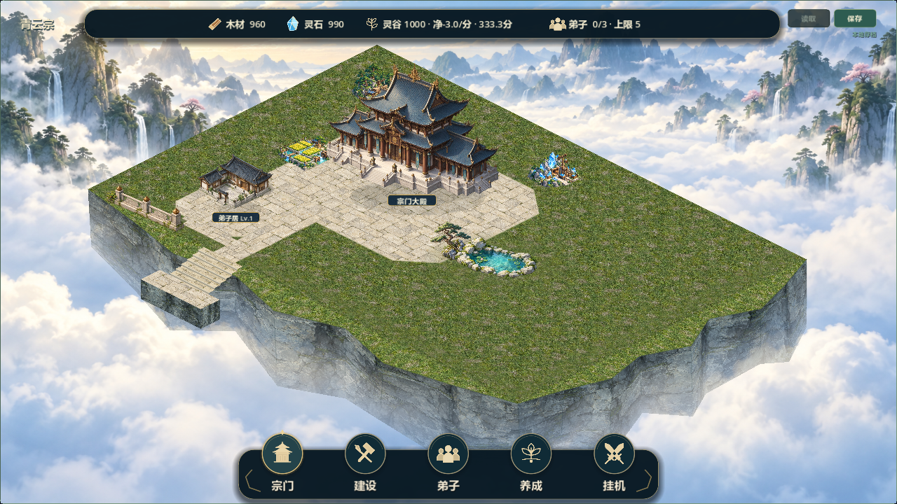

# 局部自然边缘与道路候选10

2026-10-21，V0.8阶段2，#37（V08-003）/#38（V08-004）。负责人“进行下一步整改”授权继续局部；不作为候选9或整阶段验收。

基线f3ebf88，feature/v0.8-visual-polish。本轮核对AGENTS、规划边界/铁律/协作规则、TASKS、AI_HANDOFF、CHANGELOG、SAVE_FORMAT及Issue正文/评论/阶段1验收记录；git fetch成功，相关远端仍45b35b3，本地基线领先18提交，默认分支仍docs/development-management/e936491。未切换、合并、重置或推送。另一台电脑工作区未直接核对；原docs/LOCAL_ENV_SETUP.md、tests/run_all_tests.sh保留。

## 本次实现

- sect_terrain_surface.gd：前侧两条崖岸向逻辑矩形外扩，形成起伏岩岸和草地过渡；崖底淡入云雾，底部共享顶点索引避免转角裂缝。核心平面和全部96格保留，外扩装饰不是新增可建格。
- 统一平面采用草地＋石质院落。主殿院落随固定主殿，侧翼铺装跟随已有建筑脚点并裁剪在有地面范围内。铺装按同一材质尺度分片，减少大面积重复格线和拉伸巨砖。两种材质都能按原规则建造，没有硬分区。
- sect_scene_layout.gd新增连续反投影，主殿入口短径接外沿阶，侧翼两段支路接主路。道路会避让其他建筑的实际台基；首轮截图发现对自身台基误判阻碍，修正后专项验证连通。普通路径不承诺任意密集旧档自动全图寻路。
- 一处池石园林加入羽化苔草和一件独立松石，作为深度物件排序，建造时淡化，不截获点击；与建筑相交时让位。没有烘焙功能建筑或恢复整张不可交互场景图。
- 新材质assets/environment/sect_moss_ground.png与sect_pine_rock.png由内置ImageGen生成，实际尺寸、SHA256、来源和完整最终提示词见[素材记录](../assets/environment/TERRAIN_NATURE.md)。松石保持实际图片宽高比。
- 仅--courtyard-demo启用本轮新地形，仍使用独立v08_courtyard_visual_demo.json。普通/旧全图入口未推广。12×8、104×52、主殿(4,3)、玩家身份/坐标/等级/资源、自由建造及version3不变；GameState/SaveManager未修改。

## 验证及实际截图

- Godot 4.7.2.stable.official.ed1daf0bf，RTX2060/OpenGL实际运行。57项快速调试测试退出0、有PASS、无脚本错误/ERROR；结果builds/local-validation/terrain10-test-results.json。包括旧档迁移/往返、建筑、领地、经营及战斗原有检查。
- 新test_terrain_nature.gd检查自然边缘只向外扩、边缘铺装裁剪、连续坐标往返、三段道路连接、施工阻挡让位、松石alpha及查询前后状态不变。test_terrain_baseline.gd扩为五阶段，两尺寸×两标高×五阶段×96格，共1920次程序输入映射检查。
- 最后校正松石宽高比后，自然地形/基准两专项复测通过（terrain10-post-*.log）。57项快速回归在该最后小调整之前运行，未将它写成最后源码的全量再跑。
- 五阶段两尺寸各10张（含正常、小卡、预览、整体抬高24），共20张最终图形截图退出0/PASS/无ERROR；日志terrain10-final-capture.log。已目视检查自然岸、道路、最终松石与池岸、主殿卡、建造预览。草地/庭院调整来自实际截图对比，不是只凭代码判断。
- Windows最终导出退出0/无ERROR，普通/局部/七建筑三个入口隔离APPDATA启动退出0、启动成功/无错误；日志terrain10-export.log和terrain10-package-*.log。发行包只作为独立启动证据，不代替调试断言/人工试玩。
- 未进行人工鼠标试玩、双机或联机、30分钟真实长稳、真实玩家存档人工检查；旧档证据来自隔离测试，没有读取或覆盖正式存档。

| 阶段 | 实际截图 |
|---|---|
| 0 自然岸与草地/院落基准 | [查看](art/v08-terrain10-step0.png) |
| 1 入口、连通道路和原外沿阶 | [查看](art/v08-terrain10-step1.png) |
| 2 一段栏杆 | [查看](art/v08-terrain10-step2.png) |
| 3 池水及苔草过渡 | [查看](art/v08-terrain10-step3.png) |
| 4 加一件松石 | [查看](art/v08-terrain10-step4.png) |
| 交互 | [建造预览](art/v08-terrain10-preview.png)、[主殿卡](art/v08-terrain10-hall-card.png) |

## 打开与剩余问题

双击builds/Run-Courtyard-Demo.cmd，指向QingYunSect-v0.8-terrain10-win64.exe -- --courtyard-demo。包140468432字节，SHA256 **7B01B6C7F6F30A35100609EBE89816B593E3709A7700CF99183E9113B82C3CE2**。旧全图入口仍指向open6，不代表新地形已全图推广。

后缘轮廓仍偏直，草地和右侧留白较多，主殿后资源点轮廓/颜色、云雾/岩壁细节和建筑等级独立造型仍待改善。前侧自然岸已有变化，不宣称完整四周自然轮廓或达到参考图。内部仍同标高，未做可交互多台地/桥梁/相机缩放/实际扩图。

下一步根据局部反馈完善后缘山体和少量庭园边界，继续逐件检查，保留自由建造；没有本轮自动铺满装饰或推广全图。保持open待负责人验收；#37 issuecomment-6306888018、#38 issuecomment-6306888934已记录，Project镜像未同步，源码和构建未上传。
