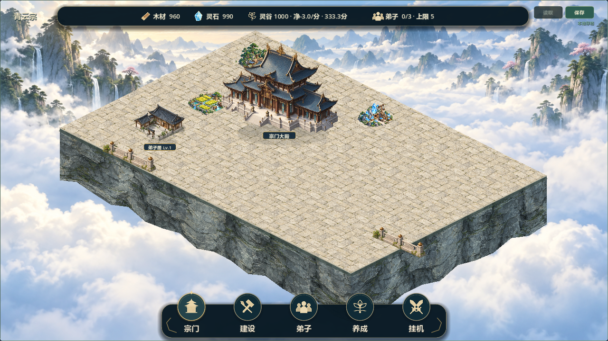
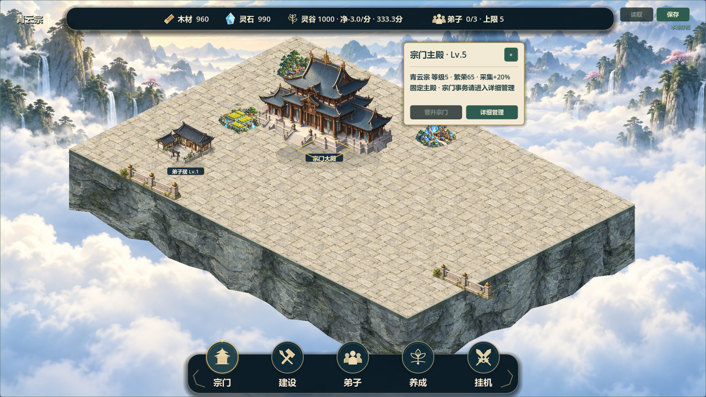
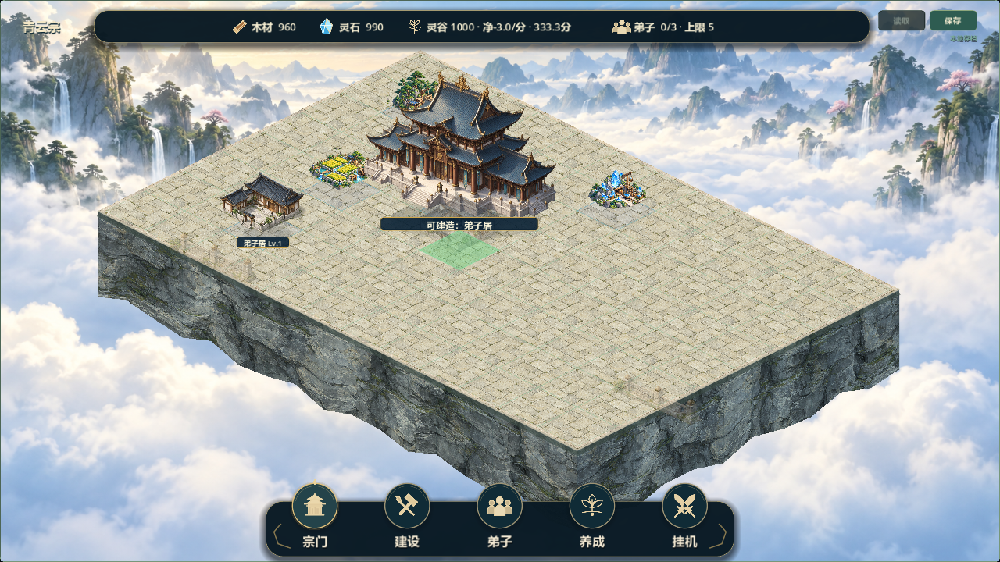

# 地形整改候选8：共面地基验证

2026-10-21，V0.8阶段2局部整改，关联#37（V08-003）、#38（V08-004）。候选7被负责人指出“明显穿模…和底层地图根本无法融合”，**未通过视觉验收**；本轮授权为“开始修整”，不是验收或全图替换授权。

## 基线及边界

基线f45ea33，feature/v0.8-visual-polish，origin为C-destiny/QingYunSect。git fetch成功；远端默认仍docs/development-management/e936491，main为b7ca7fa，相关功能远端45b35b3，本地基线领先16提交。按提交内容继续现有V0.8分支，未切换、合并、重置或推送。另一台电脑当前工作区未直接核对。开始读取仓库指令、主规划、TASKS、AI_HANDOFF、CHANGELOG、SAVE_FORMAT和Issue正文/评论；#37/#38仍open，历史V0.7已验收。原未跟踪docs/LOCAL_ENV_SETUP.md、tests/run_all_tests.sh保留。

## 已实现

- sect_terrain_surface.gd从领地配置边界生成连续地面，沿用104×52和1.45视觉间距；建筑、铺装、外缘共享sect_scene_layout.project_continuous，反向映射保留原逻辑投影。
- 新局部演示背景只承载远山云海。地面与外缘岩壁为运行时几何，悬崖不穿过内部合法格。首稿岩壁用旧场景切片出现重复瀑布/花木，已改用专用连续岩石材质。
- 去掉候选7重复台基、短阶和贴缝。建筑保留自身台基和入口；边缘低栏杆单独排序，施工脚点进入时让位，建造时透明减弱，不改变占地。
- 仅--courtyard-demo启用新地形；普通及七建筑演示保留旧底图，但已撤掉候选7失败的额外叠图。演示仍1栋弟子居(2,6)，主殿仍固定(4,3)。正式建筑不免费添加、不迁位。
- 12×8、自由建造/软分区、建筑功能和version3格式不变，没有增加持久化字段，GameState/SaveManager没有变更。边界从配置读取，不代表已实现实际扩区或多层高度。

## 验证证据

引擎Godot 4.7.2.stable.official.ed1daf0bf，RTX2060/OpenGL实际渲染。

- 55项快速调试回归：逐项退出0、含PASS、无脚本错误/ERROR；结果builds/local-validation/terrain8-test-results.json。含旧版本有效存档、往返、建造、领地、经营、装备及战斗原有检查，不读取真实玩家档。30分钟真实长稳未重跑。
- test_courtyard_fusion.gd：两尺寸验证96格中心和四角落在同一地面、正反映射、原合法性、稳定排序、实际建筑透明轮廓拾取、边缘装饰让位及保存往返一致。初次旧栏杆重叠夹具断言失败；新栏杆移到外缘已无该轮廓重叠，改为逐像素轮廓选择和实际让位验证后通过，不宣称首轮全绿。
- audit_v08_courtyard.gd：1280×720、1920×1080，各正常/侧翼卡/主殿卡/建造预览，共8图，实际图形运行退出0、有PASS、无错误。已目视检查正常、主殿卡、侧翼卡、预览；原图保留builds/v08-scene-audit/terrain8-*.png。
- Windows最终导出退出0、无ERROR，普通/局部/七建筑三入口隔离APPDATA启动退出0、启动成功且无错误。发行包只作独立启动证据，不能替代调试测试/人工试玩。日志terrain8-export-final.log、terrain8-package-*.log。
- 初次编辑器导入遇沙箱safe-save错误，改为隔离目录并获工具批准后导入成功（terrain8-import-clean.log）。首次隔离导出缺模板失败；使用本机已安装模板重导出通过。失败日志保留，不把exit0且有ERROR算通过。

包builds/QingYunSect-v0.8-terrain8-win64.exe：136598272字节，SHA256 **9CFB355E51F4FE2464CDB76A9E1AEB225894C749BB0774CD3E8A4EC61006D2BC**。

双击builds/Run-Courtyard-Demo.cmd打开新样板（参数-- --courtyard-demo）；独立user://v08_courtyard_visual_demo.json，首次has_save前切换，不读正式savegame.json。旧Run-Full-Scene-Demo.cmd仍指向open6，避免误认为新地形已推广。

## 已知问题和停止点

这是地基正确性验证，**未达到参考图的山巅美术构图**。铺装重复、规则菱形外缘明显，地面偏空，缺少道路层级、园林边界、自然崖口/云雾遮掩；资源点风格/屋顶附近轮廓仍需调整。主殿与侧翼现在没有烘焙内部悬崖/楼梯穿过，但不能据此称所有建筑、所有遮挡已人工验收。

未进行人工鼠标试玩、双机联机、30分钟真实长稳、全部旧玩家实际存档人工检查；无相机缩放或实际地图扩区。全图旧烘焙底图融合问题尚未解决，不能将局部证据写成全图完成。

下一步先等待负责人对局部地基关系反馈；随后只在局部加入道路主次、可让位园林和自然边缘。共面落地确认后才讨论多层台地，届时明确视觉高度、建筑落点和楼梯连接。未授权自动推广、关单或进入V0.9。

Issue追加记录：#37 issuecomment-6296016080、#38 issuecomment-6296018557。保持open待验收；Project镜像未同步，源码及构建未上传。素材来源与完整提示词见assets/environment/TERRAIN_LAYERS.md。
