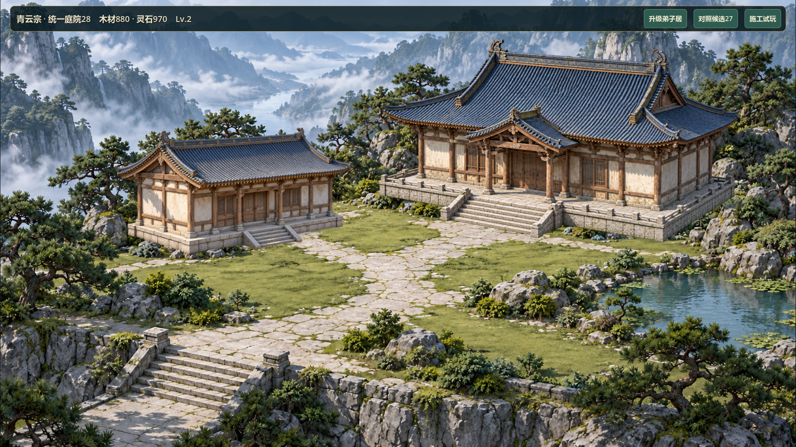

# V0.8 主殿庭院统一重制28

2026-10-27，#37/#38。负责人明确授权“重构背景和建筑都可以，按着你的想法进行修改”，取代本轮样板原来不改建筑外观的限制。继续V0.8局部实机样板，不把授权记作27/整版验收，不推广普通七院落或改玩法。

## 设计、影响与实施计划

候选27已在当前工作区，原成果和Windows包保留。本轮采用独立入口和资产，直接在当前任务分支实施，不覆盖27或他人修改。仍使用现有Godot4.7.2、原建造/升级数据及隔离样板逻辑；GameState/SaveManager、12×8/104×52、旧ID/逻辑格/资源/等级、成本工期与version3不变。新脚点与尺寸只作显示映射。回退用27原入口/包，不迁移存档。

美术方向：风格化半写实国风，青灰瓦、暖木、灰白石、低饱和松绿；主殿是五开间的庄重中枢，减少鎏金装饰和层叠小屋顶，侧翼材质与屋顶语言一致。固定正交三分之四相机，地面两轴约±0.5，左上日光/右下影。近景石材与建筑保持同一细节尺度，远景低对比。路径从左下引至主殿，主殿前保留仪式空间，植被以大组团代替碎花边，水面不抢主殿。首先生成统一场景参照，再以此派生背景与独立建筑；提示词不是精确定位或验收证据，按实际生成图校准。

修改面限新生产图、局部样板地图/入口、必要回归与审图、启动器、来源和交接文件及当前画布。复用原付费建设/升级、卡片、重置逻辑；新图需实测尺寸/alpha/脚点、双尺寸命中。若拆分后出现明显风格断层、空院残留建筑、景物压入口或新台基悬空，修正相应资产，不靠改存档/放宽点击夹具通过。

- [x] 制作统一场景参照，检查实际图并记录来源/完整提示词；仅为参考，不计实机。
- [x] 派生连续地形与独立建筑，核对透明度、材质/相机/脚点和遮挡；接入新的显式隔离入口。
- [x] 新专项先红后绿，检查两栋独立选择、空院/施工/完成/升级、原资源工期和状态不变。
- [x] 双尺寸GPU审图、快速回归、Windows串行导出与隔离图形启动；画布展示实机和来源，更新交接。Windows有环境证书ERROR，不计干净通过。

本机Windows系统证书库读取限制沿用27记录：测试可临时指定本机已有Git证书包，结束删除配置；不更改全局或把本机路径带进发布包。有ERROR的导出/启动不得记干净通过。GitHub上轮评论写入被拒绝，本轮不自动重试远端写入；源码不推送。

## 素材与实际结果

运行地形`assets/environment/courtyard-unified28.png`为1672×941 RGB，SHA256 `1833DFE86694C9BAA955B342134D4DFB1AD5927F7A1AD68D8E109DA764774A73`；主殿`assets/buildings/hall-unified28.png`为1581×995 RGBA，SHA256 `8EB2AD721EE934D95AA1CF6B3FA6E8A21D250E06D225D7574FF791A77F547586`；弟子居`assets/buildings/quarters-unified28.png`为1671×941 RGBA，SHA256 `01204D5E9566E3B5973A0B1BC768CE84948DD805B84D4B8AB17FB3847457A7B7`。两个建筑均实测混合alpha，地形无建筑残留。新资产启用mipmaps和线性缩小过滤，不改原图像素。

主殿alpha>0.1框为Rect(24,60,1550,872)，弟子居Rect(63,66,1548,825)；弟子居低alpha噪声延伸到画布边缘，因此使用实测主体框，未把画布底边当脚点。运行宽度分别760/500源画布像素，显示脚点(1175,510)/(490,535)，入口分别为主体框内(0.40,0.96)/(0.64,0.95)。这些是新样板的视觉配置，未写回保存格坐标。主殿与弟子居均独立贴图、alpha命中及选中轮廓；弟子居未建时仅地形，施工时仅对应足迹脚手架。

运行入口`--unified-courtyard-sample`在`main.gd`正式存档检查之前分流，复用旧样板付费/计时/升级及卡片方法。旧样板只新增可覆写的create_map构造方法，原27 CLI入口未改。新增样板可同状态切回27整套画面；构图和建筑外观变化是负责人本轮明确授权，不是迁移或验收。常用`Run-Hall-Courtyard-Sample.cmd`与新增`Run-Unified-Courtyard.cmd`均打开28；原27包保留。

场景参照为编辑器默认模型生成的`assets/generated/image-0e0472f1-f5c4-435e-8ee4-00dc237651d5.png`，实际1672×941。地形通过当前画布`unified28-ground`节点执行，模型codex-cli/codex-image，shared job 99f0af50-659b-47f6-b886-9718e07d82af已成功；两建筑经内置image_gen以同一场景参照作编辑输入并请求真实透明。其输出由编辑器保存为`assets/generated/codex-6d1f9d08dd4ca4890fc43d5c.png`和`codex-9136ce65ba1499d65e324722.png`，复制原文件到上述生产路径，无Python/Pillow修图或外部素材。原始输出保留；素材使用范围仅项目V0.8局部视觉样板，沿用项目AI生成素材来源规范。当前画布同ID保留提示词、参考与产物，素材图不是实机验收。

首个内置image_gen场景参考也已由编辑器保存为`assets/generated/codex-83dacafe5f7210824e0dfdc7.png`，未作为生产目标。曾尝试用node脚本写出工具返回的图像数据，被自动审批拒绝，未继续该脚本操作；改用编辑器生成/保存功能完成产物，不访问被禁止的用户配置目录。

## 验证与限制

新专项有效红测为“统一样板未实现”、退出1；完成后检查原付费/工期、升级、身份/格坐标保持、真实alpha和双尺寸独立命中/卡片/状态不变，通过。最终72项快速回归PASS/0失败/无超时，退出0，日志`builds/local-validation/20261027-133211/`；30分钟真实稳定性未执行。测试临时使用27所述已有证书包，错误日志判断未放宽，临时配置在导出前删除。

首轮全量为71 PASS/1 FAIL：旧`test_planar_courtyard.gd:55`的存读档断言失败并60秒超时（20261027-132625）。没有修改旧存档代码或放宽测试；带save/load信号诊断的原样探针两项均true，复跑通过；最终完整回归也通过。首轮失败根因未证实，保留原日志和探针结果，不称已修复，若再现应单独调查，不借本轮美术重制改核心数据。

最终GPU两尺寸共18张真实图，涵盖空院、施工、施工卡片、完成、主殿卡、弟子居卡、升级、原27对照和最终画面。新建筑在有效区域与空院相比变化采样为6204/6198，证明独立建筑实际呈现，不是烘焙背景；不是审美分数。最终GPU退出0、PASS、无ERROR，日志`builds/unified28-check/gpu-final.*`。已目视1080p全景、720p全景/空院/弟子卡/施工；最终缩小过滤后的截图已覆盖画布交付。

实际图形仍是背景烘焙地形和独立建筑贴图，未改引擎为3D；生成相机/材质相近，不声称经过全场景精确三维共面校验。没有新增人物活动、其他院落、等级独立建筑或全图推广。建筑透明图是参照派生生成，不保证逐像素保留原场景中的建筑。没有真人鼠标、独立代码审查、联机或负责人验收。正式档前后哈希仍未验证，只验证样板分流与测试/启动隔离。

当前画布保留旧27图、场景参考、生产地形/两建筑和28的同状态前后/双尺寸/空院实机图，引用检查通过；来源图与实际运行截图明确区分。GitHub #37/#38已只读核对仍open，最新更新为2026-10-26；上轮写入被拒绝，本轮不重复写远端，Project与远端本轮证据欠同步。未提交/推送，不记ACCEPTED。



Windows测试结束后串行导出退出0，包`builds/QingYunSect-v0.8-unified28-win64.exe`，186399136字节，SHA256 `EBB58B80F528400514982F88D1C9D83C939C2B5B03E5F89000C2FA2A7D3EDEEF`。新28/旧27/普通/付费施工/全景/自由建造六入口均图形模式隔离APPDATA启动，正常退出0，无脚本错误；新入口输出OpenGL及UNIFIED_COURTYARD28隔离标记。导入、导出和六次启动仍有系统根证书库ERROR，因此Windows只记已生成/已启动，不计无错误验证通过。日志`builds/unified28-check/export.*`与`smoke/`，临时测试证书配置没有进入包。

## 场景参照完整提示词

```text
A cohesive semi-realistic stylized Chinese xianxia mountain monastery courtyard for a 2.5D orthographic game, 16:9 landscape, no text/UI/people. Upper-left daylight, down-right shadows, equal material sharpness on architecture and near ground, blue-grey roofs, warm weathered timber, cream plaster, low grey-stone foundations and restrained ornament. One broad five-bay main hall upper-right of center with one dominant hip-and-gable roof and a small porch roof, entrance facing lower-left. One lower residential wing left of center, about 65 percent the hall width, matching materials/camera. Clear irregular pale limestone path enters lower-left and branches to both entrances, modest open forecourt, large grouped sage-green lawns and planted rock/pine masses replacing a giant square tiled plaza. Small subdued pond at right. Low rough stone retaining edge and entrance stair in foreground. Layered blue-grey mountain valley and mist in upper third, atmospheric low contrast. No ornate gold railing, no enormous floating slab, no tiny noisy flower borders, no pagodas, no extra functional buildings. Render as one unified environment with buildings naturally grounded, clean large forms readable at 1280x720.
```

地形完整编辑提示词保留在当前画布`unified28-ground`节点；建筑实际提示词见下。

## 主殿完整编辑提示词

```text
Extract ONLY the LARGE MAIN HALL at the RIGHT of the supplied reference into ONE isolated production game sprite on a truly transparent background with a real alpha channel. Preserve its building design, camera orientation and material appearance faithfully: dominant blue-grey hip-and-gable roof, little front porch gable, cream plaster, weathered warm timber, five-bay frontage, low grey stone platform, broad central stairs and low short stone side railings. Keep the same upper-left light and clean semi-realistic game render style. Include the COMPLETE architecture, entire foundation and stairs. REMOVE ALL landscape, trees, shrubs, pots, grass, garden rocks, paths and mountains. No square ground tile, lawn or wide shadow haze under the building. Transparent outside the architecture, no opaque or checkerboard background. Do not add gold ornament, extra stacked roofs or a tall foundation wall. Main doorway and stairs face lower-left/front exactly as reference. Full silhouette centered with about 5 percent transparent margin, no clipping. This is the MAIN HALL, not the small left residential building. No text, UI, people or other buildings.
```

## 弟子居完整编辑提示词

```text
Extract ONLY the SMALL LEFT RESIDENTIAL SIDE WING of the supplied scene into one independent transparent game sprite, with true alpha transparency. Match the reference building exactly in camera orientation, blue-grey roof pitch/tiles, weathered warm timber and cream plaster, low grey limestone foundation, and little entry steps facing toward lower-right/front. One modest single-roof residence, NOT the large main hall, NOT a walled courtyard or elaborate pavilion. Keep same upper-left sunlight, soft blue fill, semi-realistic game material rendering and proportion. Include all the roof and walls and low complete foundation/entry stair, but REMOVE the overlapping pine tree and every shrub, pot, landscape rock, grass, mountains and path. No terrain rectangle/slab, no tall pedestal, no wide shadow or ground haze. Full clean building silhouette centered with about 5 percent transparent margin, no clipping. Transparent outside architecture, including roof gaps. No checkerboard, opaque background, text, UI, people or other buildings.
```
